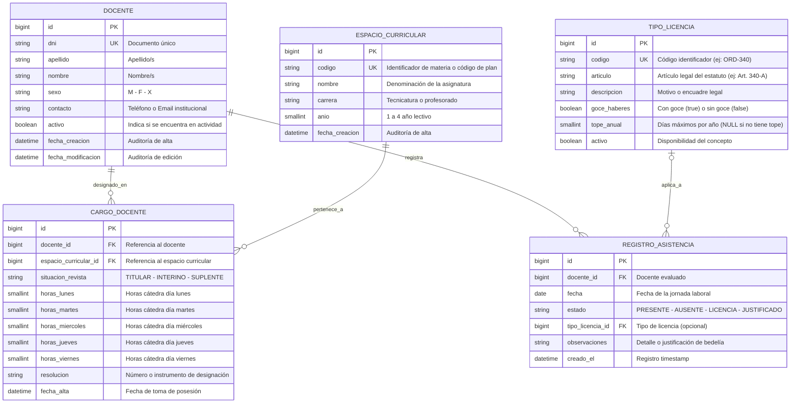

# Documentación Técnica: Modelo Entidad-Relación (DER)
## Sistema de Gestión de Asistencia y Licencias Docentes — IESETyFP

- **Institución:** Instituto de Educación Superior de Educación Técnica y Formación Profesional (IESETyFP)
- **Área:** Bedelía / Secretaría Académica
- **Módulo:** Asistencia, Carga Horaria y Régimen de Licencias
- **Motor de Base de Datos:** MySQL 8.x (con compatibilidad SQLite para desarrollo local)
- **ORM:** Django 5.x

---

## 1. Diagrama Entidad-Relación (Mermaid)

El siguiente diagrama modela la estructura de datos requerida para digitalizar y automatizar el control diario de asistencias, licencias y distribución de horas cátedra del cuerpo docente del IESETyFP.



---

## 2. Diccionario de Datos

### 2.1. Tabla: `docente`
Centraliza los datos filiatorios del personal académico de la institución.

| Campo | Tipo Django | Tipo MySQL | Restricciones | Descripción |
| :--- | :--- | :--- | :--- | :--- |
| `id` | `BigAutoField` | `BIGINT AUTO_INCREMENT` | **PK**, NOT NULL | Clave primaria autoincremental. |
| `dni` | `CharField(max_length=20)` | `VARCHAR(20)` | **UNIQUE**, NOT NULL, INDEX | Documento Nacional de Identidad. Identificador natural. |
| `apellido` | `CharField(max_length=100)` | `VARCHAR(100)` | NOT NULL | Apellido(s) del docente. |
| `nombre` | `CharField(max_length=100)` | `VARCHAR(100)` | NOT NULL | Nombre(s) del docente. |
| `sexo` | `CharField(max_length=1)` | `VARCHAR(1)` | NOT NULL | Opciones: `M` (Masculino), `F` (Femenino), `X` (No binario). |
| `contacto` | `CharField(max_length=150)` | `VARCHAR(150)` | NULLABLE | Teléfono celular, correo electrónico o medio de contacto directo. |
| `activo` | `BooleanField(default=True)` | `TINYINT(1)` | NOT NULL, DEFAULT 1 | Permite dar de baja lógica a un docente sin perder historial. |
| `fecha_creacion` | `DateTimeField(auto_now_add=True)` | `DATETIME(6)` | NOT NULL | Marca de tiempo de registro en el sistema. |
| `fecha_modificacion` | `DateTimeField(auto_now=True)` | `DATETIME(6)` | NOT NULL | Marca de tiempo de última actualización. |

---

### 2.2. Tabla: `espacio_curricular`
Representa las asignaturas, talleres o módulos de las carreras dictadas en el IESETyFP.

| Campo | Tipo Django | Tipo MySQL | Restricciones | Descripción |
| :--- | :--- | :--- | :--- | :--- |
| `id` | `BigAutoField` | `BIGINT AUTO_INCREMENT` | **PK**, NOT NULL | Clave primaria. |
| `codigo` | `CharField(max_length=30)` | `VARCHAR(30)` | **UNIQUE**, NOT NULL | Código institucional o de plan de estudio (ej: `DS-301`). |
| `nombre` | `CharField(max_length=150)` | `VARCHAR(150)` | NOT NULL | Nombre de la asignatura (ej: *Práctica Profesionalizante III*). |
| `carrera` | `CharField(max_length=150)` | `VARCHAR(150)` | NOT NULL | Nombre de la carrera / tecnicatura. |
| `anio` | `PositiveSmallIntegerField()` | `SMALLINT UNSIGNED` | NOT NULL | Año de la carrera al que corresponde (1, 2, 3, etc.). |
| `fecha_creacion` | `DateTimeField(auto_now_add=True)` | `DATETIME(6)` | NOT NULL | Fecha de alta de la asignatura. |

---

### 2.3. Tabla: `cargo_docente`
Representa la asignación concreta de un docente a un espacio curricular, su situación de revista y el desglose de horas cátedra por día hábil.

| Campo | Tipo Django | Tipo MySQL | Restricciones | Descripción |
| :--- | :--- | :--- | :--- | :--- |
| `id` | `BigAutoField` | `BIGINT AUTO_INCREMENT` | **PK**, NOT NULL | Clave primaria. |
| `docente_id` | `ForeignKey(Docente)` | `BIGINT` | **FK**, NOT NULL, `ON DELETE PROTECT` | Docente titular/designado del cargo. |
| `espacio_curricular_id` | `ForeignKey(EspacioCurricular)` | `BIGINT` | **FK**, NOT NULL, `ON DELETE PROTECT` | Asignatura asignada. |
| `situacion_revista` | `CharField(max_length=15)` | `VARCHAR(15)` | NOT NULL | `TITULAR`, `INTERINO`, `SUPLENTE`. |
| `horas_lunes` | `PositiveSmallIntegerField(default=0)` | `SMALLINT UNSIGNED` | NOT NULL, DEFAULT 0 | Horas cátedra frente a curso los lunes. |
| `horas_martes` | `PositiveSmallIntegerField(default=0)` | `SMALLINT UNSIGNED` | NOT NULL, DEFAULT 0 | Horas cátedra frente a curso los martes. |
| `horas_miercoles` | `PositiveSmallIntegerField(default=0)` | `SMALLINT UNSIGNED` | NOT NULL, DEFAULT 0 | Horas cátedra frente a curso los miércoles. |
| `horas_jueves` | `PositiveSmallIntegerField(default=0)` | `SMALLINT UNSIGNED` | NOT NULL, DEFAULT 0 | Horas cátedra frente a curso los jueves. |
| `horas_viernes` | `PositiveSmallIntegerField(default=0)` | `SMALLINT UNSIGNED` | NOT NULL, DEFAULT 0 | Horas cátedra frente a curso los viernes. |
| `resolucion` | `CharField(max_length=100)` | `VARCHAR(100)` | NULLABLE | Número o instrumento legal de alta (ej: `Res. 1420/24-ME`). |
| `fecha_alta` | `DateField(null=True, blank=True)` | `DATE` | NULLABLE | Fecha de posesión del cargo. |

---

### 2.4. Tabla: `tipo_licencia`
Catálogo normativo de las licencias del régimen docente (Estatuto del Docente / Reglamentación provincial o institucional).

| Campo | Tipo Django | Tipo MySQL | Restricciones | Descripción |
| :--- | :--- | :--- | :--- | :--- |
| `id` | `BigAutoField` | `BIGINT AUTO_INCREMENT` | **PK**, NOT NULL | Clave primaria. |
| `codigo` | `CharField(max_length=20)` | `VARCHAR(20)` | **UNIQUE**, NOT NULL | Código nemotécnico (ej: `LIC-340A`, `ENF-CORTO`). |
| `articulo` | `CharField(max_length=50)` | `VARCHAR(50)` | NOT NULL | Referencia legal exacta (ej: *Art. 340 inc. A - Enfermedad*). |
| `descripcion` | `CharField(max_length=255)` | `VARCHAR(255)` | NOT NULL | Denominación o alcance del artículo. |
| `goce_haberes` | `BooleanField(default=True)` | `TINYINT(1)` | NOT NULL, DEFAULT 1 | `True` = Con goce de sueldo; `False` = Sin goce de haberes. |
| `tope_anual` | `PositiveSmallIntegerField(null=True)` | `SMALLINT UNSIGNED` | NULLABLE | Cantidad máxima de días computables al año. `NULL` si no posee límite. |
| `activo` | `BooleanField(default=True)` | `TINYINT(1)` | NOT NULL, DEFAULT 1 | Si el artículo está vigente en el sistema. |

---

### 2.5. Tabla: `registro_asistencia`
Registra el parte diario de novedades de bedelía por docente y fecha.

| Campo | Tipo Django | Tipo MySQL | Restricciones | Descripción |
| :--- | :--- | :--- | :--- | :--- |
| `id` | `BigAutoField` | `BIGINT AUTO_INCREMENT` | **PK**, NOT NULL | Clave primaria. |
| `docente_id` | `ForeignKey(Docente)` | `BIGINT` | **FK**, NOT NULL, `ON DELETE CASCADE` | Docente al que pertenece el parte diario. |
| `fecha` | `DateField()` | `DATE` | NOT NULL, INDEX | Jornada escolar registrada. |
| `estado` | `CharField(max_length=15)` | `VARCHAR(15)` | NOT NULL | `PRESENTE`, `AUSENTE`, `LICENCIA`, `JUSTIFICADO`. |
| `tipo_licencia_id` | `ForeignKey(TipoLicencia)` | `BIGINT` | **FK**, NULLABLE, `ON DELETE SET_NULL` | Artículo legal que encuadra la inasistencia. |
| `observaciones` | `TextField(blank=True)` | `TEXT` | NULLABLE | Notas del bedel, justificación o número de certificado médico. |
| `creado_el` | `DateTimeField(auto_now_add=True)` | `DATETIME(6)` | NOT NULL | Fecha y hora exacta de registro. |

---

## 3. Enumeraciones y Opciones del Sistema (Choices)

### Situación de Revista (`CargoDocente.situacion_revista`)
- `TITULAR`: Designación por concurso / titularidad definitiva.
- `INTERINO`: Vacante en interinato sujeta a proceso de cobertura.
- `SUPLENTE`: Reemplazo transitorio por licencia del titular/interino.

### Estado de Asistencia (`RegistroAsistencia.estado`)
- `PRESENTE`: El docente asistió a cumplir sus horas según horario.
- `AUSENTE`: Inasistencia injustificada no encuadrada.
- `LICENCIA`: Inasistencia amparada bajo un régimen del estatuto (`tipo_licencia_id` obligatorio en validación).
- `JUSTIFICADO`: Inasistencia justificada por causas especiales (paro de transporte, comisión de servicio institucional).

### Sexo (`Docente.sexo`)
- `M`: Masculino
- `F`: Femenino
- `X`: No binario / Otro

---

## 4. Reglas de Integridad Referencial y Lógica de Negocio

1. **Unicidad de Asistencia Diaria:**
   - Un docente solo puede tener **un único registro de asistencia por día**.
   - Se debe aplicar una restricción de clave única compuesta:
     ```python
     constraints = [
         models.UniqueConstraint(fields=['docente', 'fecha'], name='unique_asistencia_docente_fecha')
     ]
     ```

2. **Cómputo de Horas según el Día de la Semana:**
   - La distribución `horas_lunes` a `horas_viernes` en `CargoDocente` permite al sistema deducir de forma automática cuántas horas cátedra correspondían en la `fecha` evaluada según `fecha.weekday()`:
     - `0` = Lunes &rarr; `horas_lunes`
     - `1` = Martes &rarr; `horas_martes`
     - `2` = Miércoles &rarr; `horas_miercoles`
     - `3` = Jueves &rarr; `horas_jueves`
     - `4` = Viernes &rarr; `horas_viernes`
   - Si un docente figura con estado `AUSENTE` o `LICENCIA`, el impacto en horas no asistidas se calcula automáticamente sumando las horas de todos sus cargos correspondientes a ese día.

3. **Consistencia de Licencias:**
   - Si el `estado` es `LICENCIA`, el campo `tipo_licencia_id` es mandatorio en la validación a nivel formulario o modelo (`clean()`).
   - Si el `estado` es `PRESENTE`, el campo `tipo_licencia_id` debe ser `NULL`.

4. **Políticas de Eliminación (`ON DELETE`):**
   - Si se elimina un `Docente`, sus registros de `RegistroAsistencia` se eliminan en cascada (`CASCADE`), pero sus cargos (`CargoDocente`) están protegidos con `PROTECT` para evitar pérdidas accidentales de asignaciones curriculares históricas.
   - Si se elimina un `TipoLicencia`, los registros de asistencia históricos preservan la novedad dejando `tipo_licencia_id` en `NULL` (`SET_NULL`).

---

## 5. Implementación de Referencia en Django ORM

A continuación se presenta la definición en código Python de los modelos mapeados para `gestion_asistencia/models.py`:

```python
from django.db import models
from django.core.exceptions import ValidationError


class Docente(models.Model):
    SEXO_CHOICES = [
        ('M', 'Masculino'),
        ('F', 'Femenino'),
        ('X', 'No binario'),
    ]

    dni = models.CharField(max_length=20, unique=True, verbose_name="DNI")
    apellido = models.CharField(max_length=100, verbose_name="Apellido")
    nombre = models.CharField(max_length=100, verbose_name="Nombre")
    sexo = models.CharField(max_length=1, choices=SEXO_CHOICES, default='M', verbose_name="Sexo")
    contacto = models.CharField(max_length=150, blank=True, null=True, verbose_name="Contacto (Teléfono/Email)")
    activo = models.BooleanField(default=True, verbose_name="Activo")
    fecha_creacion = models.DateTimeField(auto_now_add=True, verbose_name="Fecha de Creación")
    fecha_modificacion = models.DateTimeField(auto_now=True, verbose_name="Fecha de Modificación")

    class Meta:
        verbose_name = "Docente"
        verbose_name_plural = "Docentes"
        ordering = ['apellido', 'nombre']

    def __str__(self):
        return f"{self.apellido}, {self.nombre} (DNI: {self.dni})"


class EspacioCurricular(models.Model):
    codigo = models.CharField(max_length=30, unique=True, verbose_name="Código de Espacio")
    nombre = models.CharField(max_length=150, verbose_name="Nombre de la Asignatura")
    carrera = models.CharField(max_length=150, verbose_name="Carrera")
    anio = models.PositiveSmallIntegerField(verbose_name="Año de la Carrera")
    fecha_creacion = models.DateTimeField(auto_now_add=True, verbose_name="Fecha de Creación")

    class Meta:
        verbose_name = "Espacio Curricular"
        verbose_name_plural = "Espacios Curriculares"
        ordering = ['carrera', 'anio', 'nombre']

    def __str__(self):
        return f"{self.codigo} - {self.nombre} ({self.carrera} - {self.anio}° Año)"


class CargoDocente(models.Model):
    SITUACION_CHOICES = [
        ('TITULAR', 'Titular'),
        ('INTERINO', 'Interino'),
        ('SUPLENTE', 'Suplente'),
    ]

    docente = models.ForeignKey(
        Docente, on_delete=models.PROTECT, related_name='cargos', verbose_name="Docente"
    )
    materia = models.ForeignKey(
        EspacioCurricular, on_delete=models.PROTECT, related_name='cargos', verbose_name="Espacio Curricular"
    )
    situacion_revista = models.CharField(
        max_length=15, choices=SITUACION_CHOICES, default='INTERINO', verbose_name="Situación de Revista"
    )
    horas_lunes = models.PositiveSmallIntegerField(default=0, verbose_name="Horas Lunes")
    horas_martes = models.PositiveSmallIntegerField(default=0, verbose_name="Horas Martes")
    horas_miercoles = models.PositiveSmallIntegerField(default=0, verbose_name="Horas Miércoles")
    horas_jueves = models.PositiveSmallIntegerField(default=0, verbose_name="Horas Jueves")
    horas_viernes = models.PositiveSmallIntegerField(default=0, verbose_name="Horas Viernes")
    resolucion = models.CharField(max_length=100, blank=True, null=True, verbose_name="Resolución de Designación")
    fecha_alta = models.DateField(blank=True, null=True, verbose_name="Fecha de Alta")

    class Meta:
        verbose_name = "Cargo Docente"
        verbose_name_plural = "Cargos Docentes"

    def __str__(self):
        return f"{self.docente} en {self.materia.nombre} ({self.situacion_revista})"

    @property
    def total_horas_semanales(self):
        return (
            self.horas_lunes + self.horas_martes + self.horas_miercoles +
            self.horas_jueves + self.horas_viernes
        )


class TipoLicencia(models.Model):
    codigo = models.CharField(max_length=20, unique=True, verbose_name="Código")
    articulo = models.CharField(max_length=50, verbose_name="Artículo Legal (ej: 340-A)")
    descripcion = models.CharField(max_length=255, verbose_name="Descripción")
    goce_haberes = models.BooleanField(default=True, verbose_name="Goce de Haberes")
    tope_anual = models.PositiveSmallIntegerField(
        null=True, blank=True, verbose_name="Tope Anual (Días)",
        help_text="Dejar en blanco si no tiene tope anual fijado."
    )
    activo = models.BooleanField(default=True, verbose_name="Activo")

    class Meta:
        verbose_name = "Tipo de Licencia"
        verbose_name_plural = "Tipos de Licencias"
        ordering = ['codigo']

    def __str__(self):
        goce = "C/Goce" if self.goce_haberes else "S/Goce"
        return f"{self.articulo} ({self.codigo}) - {self.descripcion} [{goce}]"


class RegistroAsistencia(models.Model):
    ESTADO_CHOICES = [
        ('PRESENTE', 'Presente'),
        ('AUSENTE', 'Ausente'),
        ('LICENCIA', 'Licencia'),
        ('JUSTIFICADO', 'Justificado'),
    ]

    docente = models.ForeignKey(
        Docente, on_delete=models.CASCADE, related_name='asistencias', verbose_name="Docente"
    )
    fecha = models.DateField(verbose_name="Fecha")
    estado = models.CharField(
        max_length=15, choices=ESTADO_CHOICES, default='PRESENTE', verbose_name="Estado de Asistencia"
    )
    tipo_licencia = models.ForeignKey(
        TipoLicencia, on_delete=models.SET_NULL, null=True, blank=True,
        related_name='registros_asistencia', verbose_name="Tipo de Licencia"
    )
    observaciones = models.TextField(blank=True, verbose_name="Observaciones / Justificación")
    creado_el = models.DateTimeField(auto_now_add=True, verbose_name="Registrado el")

    class Meta:
        verbose_name = "Registro de Asistencia"
        verbose_name_plural = "Registros de Asistencia"
        constraints = [
            models.UniqueConstraint(fields=['docente', 'fecha'], name='unique_docente_asistencia_diaria')
        ]
        ordering = ['-fecha', 'docente__apellido']

    def clean(self):
        super().clean()
        if self.estado == 'LICENCIA' and not self.tipo_licencia:
            raise ValidationError({'tipo_licencia': 'Debe especificar el Tipo de Licencia cuando el estado es LICENCIA.'})
        if self.estado == 'PRESENTE' and self.tipo_licencia:
            raise ValidationError({'tipo_licencia': 'No debe asignar un Tipo de Licencia si el estado es PRESENTE.'})

    def __str__(self):
        return f"{self.fecha} - {self.docente}: {self.get_estado_display()}"
```
