# Documentación Técnica: Modelo Entidad-Relación (DER)
## Sistema de Gestión de Asistencia y Licencias Docentes — IESETyFP
### Adecuación Oficial: Documento de Requerimientos y Especificación Funcional v2.0

- **Institución:** Instituto de Educación Superior de Educación Técnica y Formación Profesional (IESETyFP)
- **Área:** Bedelía / Secretaría Académica
- **Módulo:** Asistencia, Carga Horaria, Régimen de Licencias y Formularios Oficiales de la Provincia del Chaco
- **Formularios Oficiales Integrados:** Formulario N° 1 de Agente, Formulario DP-01 (Designaciones y Suplencias), Formularios IL-01 / IL-02 (PDF Maestro Hojas 1 a 6) y compatibilidad DL-01 / DL-02
- **Reglas de Negocio Oficiales:** RN-01 a RN-11 (Especificación Funcional v2.0)
- **Motor de Base de Datos:** MySQL 8.x (con compatibilidad SQLite para desarrollo local)
- **ORM:** Django 5.x

---

## 1. Diagrama Entidad-Relación (Mermaid)

El siguiente diagrama modela la estructura relacional completa, incorporando los catálogos administrables, auditoría de usuarios, desglose mensual por materia y las reglas de negocio RN-01 a RN-11:

```mermaid
erDiagram
    DOCENTE ||--o{ CARGO_DOCENTE : "designado_en (RN-01, RN-02)"
    DOCENTE |o--o{ CARGO_DOCENTE : "reemplazado_en (DP-01)"
    ESPACIO_CURRICULAR |o--o{ CARGO_DOCENTE : "asignatura_dictada"
    CARRERA |o--o{ CARGO_DOCENTE : "carrera_ref (RN-03)"
    CARGO_CATALOGO |o--o{ CARGO_DOCENTE : "cargo_catalogo (RN-03)"
    TIPO_AUTORIZACION |o--o{ CARGO_DOCENTE : "tipo_autorizacion (RN-03)"
    DOCENTE ||--o{ REGISTRO_ASISTENCIA : "registra_asistencia"
    CARGO_DOCENTE |o--o{ REGISTRO_ASISTENCIA : "cargo_afectado (RF-07)"
    TIPO_LICENCIA |o--o{ REGISTRO_ASISTENCIA : "encuadre_licencia (RN-04, RN-05)"
    DOCENTE ||--o{ RENGLON_PLANILLA_MENSUAL : "desglosado_en (RF-12, RN-10)"
    CARGO_DOCENTE ||--o{ RENGLON_PLANILLA_MENSUAL : "cargo_afectado (RF-13)"
    TIPO_LICENCIA |o--o{ RENGLON_PLANILLA_MENSUAL : "encuadre_normativo (RF-15)"

    DOCENTE {
        bigint id PK
        string dni UK "Documento único (RN-01)"
        string tipo_documento "DNI - LC - CI"
        string apellido "Apellido/s"
        string nombre "Nombre/s"
        string sexo "M - F - X"
        date fecha_nacimiento "Fecha natalicio"
        string estado_civil "Soltero - Casado - Divorciado"
        string nacionalidad "País de origen"
        string cuil_dgi "CUIL / N° Inscripción DGI"
        string inscripcion_dgr "N° Inscripción DGR Chaco"
        string domicilio_calle "Calle y N° / Nomenclatura"
        string barrio "Barrio de residencia"
        string localidad "Localidad de radicación"
        string codigo_postal "Código Postal"
        string provincia "Provincia de radicación"
        string contacto "Teléfono o Email institucional"
        boolean activo "Indica si se encuentra en actividad"
        datetime fecha_creacion "Auditoría de alta"
        datetime fecha_modificacion "Auditoría de edición"
        bigint creado_por_id FK "Usuario creador (RN-10)"
        bigint modificado_por_id FK "Usuario modificador (RN-10)"
    }

    CARRERA {
        bigint id PK
        string codigo UK "Identificador de carrera (RN-03)"
        string nombre "Denominación oficial de la carrera"
        boolean activo "Estado de vigencia"
    }

    CARGO_CATALOGO {
        bigint id PK
        string codigo UK "Código normalizado de cargo (RN-03)"
        string descripcion "Descripción institucional"
        boolean activo "Estado de vigencia"
    }

    TIPO_AUTORIZACION {
        bigint id PK
        string nombre UK "Tipo: RESOLUCIÓN, DISPOSICIÓN (RN-03)"
        boolean activo "Estado de vigencia"
    }

    ESPACIO_CURRICULAR {
        bigint id PK
        string codigo UK "Identificador de materia o código de plan"
        string nombre "Denominación de la asignatura"
        string carrera "Tecnicatura o profesorado"
        smallint anio "1 a 4 año lectivo"
        string comision "UNICA - A - B - C"
        string turno "MANANA - TARDE - NOCHE"
        string regimen "ANUAL - CUAT_1 - CUAT_2"
        string aula "Aula o espacio físico asignado"
        string plan_estudio "Plan de estudio institucional"
        datetime fecha_creacion "Auditoría de alta"
    }

    CARGO_DOCENTE {
        bigint id PK
        bigint docente_id FK "Docente titular del cargo (RN-01, RN-02)"
        bigint carrera_ref_id FK "Catálogo de Carrera (RN-03)"
        bigint cargo_catalogo_id FK "Catálogo de Cargo (RN-03)"
        bigint tipo_autorizacion_id FK "Tipo de Autorización (RN-03)"
        string tipo_cargo "HORAS_CATEDRA o CARGO_ADM"
        string codigo_cargo "Código de cargo presupuestario"
        string codigo_motivo "Código de motivo de cobertura (DP-01)"
        bigint espacio_curricular_id FK "Espacio curricular (NULL en cargos adm)"
        string situacion_revista "TITULAR - INTERINO - SUPLENTE - TIT - INT - SUP (RN-02)"
        bigint docente_reemplazado_id FK "Docente reemplazado en suplencia (DP-01)"
        string numero_autorizacion "Número de instrumento legal (RN-03)"
        int anio_autorizacion "Año de instrumento legal (RN-03)"
        string organismo_emisor "Organismo emisor del acto (RN-03)"
        smallint horas_lunes "Horas cátedra numéricas"
        smallint horas_martes "Horas cátedra numéricas"
        smallint horas_miercoles "Horas cátedra numéricas"
        smallint horas_jueves "Horas cátedra numéricas"
        smallint horas_viernes "Horas cátedra numéricas"
        string dia_lunes "Día lunes texto (RN-03)"
        string dia_martes "Día martes texto (RN-03)"
        string dia_miercoles "Día miércoles texto (RN-03)"
        string dia_jueves "Día jueves texto (RN-03)"
        string dia_viernes "Día viernes texto (RN-03)"
        string desde_texto "Desde texto: SIN INICIO (RN-09)"
        string hasta_texto "Hasta texto: SIN TERMINO (RN-09)"
        string resolucion "Instrumento de designación complementario"
        date fecha_alta "Fecha formal de toma de posesión"
        date fecha_baja "Fecha de cese"
        boolean activo "Indica si el cargo está activo"
        text observaciones "Anotaciones de carga histórica"
        bigint creado_por_id FK "Usuario creador (RN-10)"
        bigint modificado_por_id FK "Usuario modificador (RN-10)"
    }

    TIPO_LICENCIA {
        bigint id PK
        string codigo UK "Código identificador (ej: LIC-340A)"
        string articulo "Artículo legal del estatuto"
        string descripcion "Motivo o encuadre legal"
        string categoria "LICENCIA - PERMISO - INASISTENCIA"
        string forma_pago "CON_GOCE - SIN_GOCE - CINCUENTA_PORCIENTO"
        boolean goce_haberes "Con goce (true) o sin goce (false)"
        smallint tope_anual "Días máximos por año"
        string situacion_revista_aplicable "Revistas elegibles (RN-05)"
        string tipo_novedad_excel "Tipo según catálogo original"
        string cantidad_duracion "Cantidad / Duración admitida"
        string cuadro_mensual "IL-01, IL-02, DL-01, DL-02 (RN-04, RN-05)"
        string hoja_pdf "Hojas 1-2 o 3-6 en PDF maestro"
        boolean activo "Disponibilidad del concepto"
        bigint creado_por_id FK "Usuario creador (RN-10)"
        bigint modificado_por_id FK "Usuario modificador (RN-10)"
    }

    DIA_NO_LABORABLE {
        bigint id PK
        date fecha UK "Fecha no laborable (RN-10)"
        string tipo "FERIADO - ASUETO - NO_LABORABLE (RN-10)"
        string descripcion "Motivo o denominación"
        bigint creado_por_id FK "Usuario auditor (RN-10)"
        datetime creado_en "Marca temporal de alta"
    }

    REGISTRO_ASISTENCIA {
        bigint id PK
        bigint docente_id FK "Docente evaluado"
        bigint cargo_id FK "Cargo opcional (NULL a nivel agente, RF-07)"
        date fecha "Fecha inicial del parte diario"
        date fecha_hasta "Fecha límite (RN-06: solo 1 día en inasistencias)"
        string estado "PRESENTE - AUSENTE - LICENCIA - JUSTIFICADO"
        string marca_diaria "P - I - LIC - LT - PR - INA - PERM (RF-08)"
        string oficina "Código de oficina: 1452 (RN-07)"
        int anio_planilla "Año de planilla: 2026 (RN-08)"
        boolean justifica "Indica si justifica haberes"
        bigint tipo_licencia_id FK "Tipo de licencia (opcional)"
        string numero_disposicion "Disposición aprobatoria correlativa (RF-16)"
        string observaciones "Detalle o justificación de bedelía"
        datetime creado_el "Registro timestamp"
        bigint creado_por_id FK "Usuario creador (RN-10)"
        bigint modificado_por_id FK "Usuario modificador (RN-10)"
    }

    RENGLON_PLANILLA_MENSUAL {
        bigint id PK
        bigint docente_id FK "Docente titular del renglón (RF-12)"
        bigint cargo_id FK "Cargo o materia afectada (RF-13)"
        bigint tipo_licencia_id FK "Tipo de licencia / encuadre (RF-15)"
        string cuadro "IL-01 o IL-02 (RF-15)"
        smallint mes "Mes de la novedad (1 a 12)"
        int anio "Año de la planilla (2026, RN-08)"
        string oficina "Oficina emisora: 1452 (RN-07)"
        date desde "Fecha inicio del bloque continuo (RF-14)"
        date hasta "Fecha fin del bloque continuo (RF-14)"
        int horas_afectadas "Horas cátedra acumuladas (RF-13)"
        string marca_origen "Marca de asistencia diaria (RF-08)"
        string tipo_instrumento "DISPOSICION o RESOLUCION (RF-16)"
        string numero_instrumento "N° correlativo anual 001/2026 (RF-16, RN-11)"
        bigint creado_por_id FK "Usuario auditor (RF-20, RN-10)"
        bigint modificado_por_id FK "Usuario auditor (RF-20, RN-10)"
        datetime creado_en "Timestamp de generación"
        datetime actualizado_en "Timestamp de actualización"
    }
```



---

## 2. Diccionario de Datos

### 2.1. Tabla: `docente`
Centraliza los datos filiatorios, previsionales y de contacto del personal del IESETyFP (Formulario N° 1 de Agente - Chaco).

| Campo | Tipo Django | Tipo MySQL | Restricciones | Descripción |
| :--- | :--- | :--- | :--- | :--- |
| `id` | `BigAutoField` | `BIGINT AUTO_INCREMENT` | **PK**, NOT NULL | Clave primaria autoincremental. |
| `dni` | `CharField(max_length=20)` | `VARCHAR(20)` | **UNIQUE**, NOT NULL, INDEX | Documento Nacional de Identidad (**RN-01**). |
| `tipo_documento` | `CharField(max_length=10)` | `VARCHAR(10)` | NULLABLE, DEFAULT 'DNI' | Tipo de documento (DNI, LC, CI, Pasaporte). |
| `apellido` | `CharField(max_length=100)` | `VARCHAR(100)` | NOT NULL | Apellido(s) del agente docente. |
| `nombre` | `CharField(max_length=100)` | `VARCHAR(100)` | NOT NULL | Nombre(s) del agente docente. |
| `sexo` | `CharField(max_length=1)` | `VARCHAR(1)` | NOT NULL | Opciones: `M` (Masculino), `F` (Femenino), `X` (No binario). |
| `fecha_nacimiento` | `DateField()` | `DATE` | NULLABLE | Fecha de nacimiento del docente. |
| `estado_civil` | `CharField(max_length=20)` | `VARCHAR(20)` | NULLABLE | Estado civil (Soltero/a, Casado/a, Divorciado/a, Viudo/a). |
| `nacionalidad` | `CharField(max_length=50)` | `VARCHAR(50)` | NULLABLE, DEFAULT 'Argentina' | Nacionalidad del agente. |
| `cuil_dgi` | `CharField(max_length=20)` | `VARCHAR(20)` | NULLABLE | CUIL / N° Inscripción DGI (Form. N° 1). |
| `inscripcion_dgr` | `CharField(max_length=20)` | `VARCHAR(20)` | NULLABLE | N° Inscripción DGR Provincia del Chaco. |
| `domicilio_calle` | `CharField(max_length=150)` | `VARCHAR(150)` | NULLABLE | Calle y N° / Nomenclatura catastral de residencia. |
| `barrio` | `CharField(max_length=100)` | `VARCHAR(100)` | NULLABLE | Barrio del domicilio particular. |
| `localidad` | `CharField(max_length=100)` | `VARCHAR(100)` | NULLABLE, DEFAULT 'Resistencia' | Localidad del domicilio. |
| `codigo_postal` | `CharField(max_length=10)` | `VARCHAR(10)` | NULLABLE, DEFAULT '3500' | Código postal provincial. |
| `provincia` | `CharField(max_length=50)` | `VARCHAR(50)` | NULLABLE, DEFAULT 'Chaco' | Provincia de radicación. |
| `contacto` | `CharField(max_length=150)` | `VARCHAR(150)` | NULLABLE | Teléfono celular, correo institucional o de contacto. |
| `activo` | `BooleanField(default=True)` | `TINYINT(1)` | NOT NULL, DEFAULT 1 | Estado de actividad laboral del docente. |
| `fecha_creacion` | `DateTimeField(auto_now_add=True)` | `DATETIME(6)` | NOT NULL | Timestamp de alta en el sistema. |
| `fecha_modificacion` | `DateTimeField(auto_now=True)` | `DATETIME(6)` | NOT NULL | Timestamp de última actualización. |
| `creado_por_id` | `ForeignKey(User)` | `BIGINT` | **FK**, NULLABLE, `ON DELETE SET_NULL` | Usuario que registró al docente (**RN-10**). |
| `modificado_por_id` | `ForeignKey(User)` | `BIGINT` | **FK**, NULLABLE, `ON DELETE SET_NULL` | Último usuario que modificó al docente (**RN-10**). |

---

### 2.2. Tabla: `espacio_curricular`
Representa asignaturas, materias, talleres o módulos de las carreras formativas.

| Campo | Tipo Django | Tipo MySQL | Restricciones | Descripción |
| :--- | :--- | :--- | :--- | :--- |
| `id` | `BigAutoField` | `BIGINT AUTO_INCREMENT` | **PK**, NOT NULL | Clave primaria. |
| `codigo` | `CharField(max_length=30)` | `VARCHAR(30)` | **UNIQUE**, NOT NULL | Código institucional (ej: `DS-301`). |
| `nombre` | `CharField(max_length=150)` | `VARCHAR(150)` | NOT NULL | Nombre de la asignatura. |
| `carrera` | `CharField(max_length=150)` | `VARCHAR(150)` | NOT NULL | Denominación textual de carrera. |
| `anio` | `PositiveSmallIntegerField()` | `SMALLINT UNSIGNED` | NOT NULL | Año de cursado (1 a 4). |
| `comision` | `CharField(max_length=10)` | `VARCHAR(10)` | NOT NULL, DEFAULT 'UNICA' | Comisión: `UNICA`, `A`, `B`, `C`. |
| `turno` | `CharField(max_length=10)` | `VARCHAR(10)` | NOT NULL, DEFAULT 'NOCHE' | Turno: `MANANA`, `TARDE`, `NOCHE`. |
| `regimen` | `CharField(max_length=10)` | `VARCHAR(10)` | NOT NULL, DEFAULT 'ANUAL' | Régimen: `ANUAL`, `CUAT_1`, `CUAT_2`. |
| `aula` | `CharField(max_length=50)` | `VARCHAR(50)` | NULLABLE | Aula o laboratorio físico. |
| `plan_estudio` | `CharField(max_length=50)` | `VARCHAR(50)` | NULLABLE | Resolución de plan de estudio. |
| `fecha_creacion` | `DateTimeField(auto_now_add=True)` | `DATETIME(6)` | NOT NULL | Timestamp de alta. |

---

### 2.3. Tabla: `carrera`
Catálogo administrable de carreras técnicas y profesorados (**RN-03**).

| Campo | Tipo Django | Tipo MySQL | Restricciones | Descripción |
| :--- | :--- | :--- | :--- | :--- |
| `id` | `BigAutoField` | `BIGINT AUTO_INCREMENT` | **PK**, NOT NULL | Clave primaria. |
| `codigo` | `CharField(max_length=20)` | `VARCHAR(20)` | **UNIQUE**, NOT NULL | Código identificador (ej: `TSDS`). |
| `nombre` | `CharField(max_length=150)` | `VARCHAR(150)` | NOT NULL | Nombre oficial de la carrera. |
| `activo` | `BooleanField(default=True)` | `TINYINT(1)` | NOT NULL, DEFAULT 1 | Vigencia de la oferta académica. |

---

### 2.4. Tabla: `cargo_catalogo`
Catálogo administrable de cargos docentes y de gestión institucional (**RN-03**).

| Campo | Tipo Django | Tipo MySQL | Restricciones | Descripción |
| :--- | :--- | :--- | :--- | :--- |
| `id` | `BigAutoField` | `BIGINT AUTO_INCREMENT` | **PK**, NOT NULL | Clave primaria. |
| `codigo` | `CharField(max_length=30)` | `VARCHAR(30)` | **UNIQUE**, NOT NULL | Código interno/oficial de cargo. |
| `descripcion` | `CharField(max_length=150)` | `VARCHAR(150)` | NOT NULL | Descripción o denominación funcional. |
| `activo` | `BooleanField(default=True)` | `TINYINT(1)` | NOT NULL, DEFAULT 1 | Vigencia en catálogo. |

---

### 2.5. Tabla: `tipo_autorizacion`
Catálogo administrable del tipo de instrumento administrativo que respalda la designación (**RN-03**).

| Campo | Tipo Django | Tipo MySQL | Restricciones | Descripción |
| :--- | :--- | :--- | :--- | :--- |
| `id` | `BigAutoField` | `BIGINT AUTO_INCREMENT` | **PK**, NOT NULL | Clave primaria. |
| `nombre` | `CharField(max_length=50)` | `VARCHAR(50)` | **UNIQUE**, NOT NULL | Ej: `RESOLUCIÓN`, `DISPOSICIÓN`. |
| `activo` | `BooleanField(default=True)` | `TINYINT(1)` | NOT NULL, DEFAULT 1 | Vigencia del instrumento. |

---

### 2.6. Tabla: `cargo_docente`
Designación de un docente en un espacio curricular o función institucional (Formulario DP-01, **RN-02**, **RN-03**, **RN-09**).

| Campo | Tipo Django | Tipo MySQL | Restricciones | Descripción |
| :--- | :--- | :--- | :--- | :--- |
| `id` | `BigAutoField` | `BIGINT AUTO_INCREMENT` | **PK**, NOT NULL | Clave primaria. |
| `docente_id` | `ForeignKey(Docente)` | `BIGINT` | **FK**, NOT NULL, `ON DELETE PROTECT` | Agente titular del cargo (**RN-01**, **RN-02**). |
| `carrera_ref_id` | `ForeignKey(Carrera)` | `BIGINT` | **FK**, NULLABLE, `ON DELETE SET_NULL` | Carrera vinculada del catálogo (**RN-03**). |
| `cargo_catalogo_id` | `ForeignKey(CargoCatalogo)` | `BIGINT` | **FK**, NULLABLE, `ON DELETE SET_NULL` | Cargo referenciado del catálogo (**RN-03**). |
| `tipo_autorizacion_id` | `ForeignKey(TipoAutorizacion)`| `BIGINT` | **FK**, NULLABLE, `ON DELETE SET_NULL` | Tipo de instrumento de designación (**RN-03**). |
| `tipo_cargo` | `CharField(max_length=20)` | `VARCHAR(20)` | NOT NULL, DEFAULT 'HORAS_CATEDRA' | `HORAS_CATEDRA` o `CARGO_ADM`. |
| `codigo_cargo` | `CharField(max_length=50)` | `VARCHAR(50)` | NULLABLE | Código interno o presupuestario. |
| `codigo_motivo` | `CharField(max_length=10)` | `VARCHAR(10)` | NULLABLE | Motivo de cobertura según DP-01. |
| `materia_id` | `ForeignKey(EspacioCurricular)`| `BIGINT` | **FK**, NULLABLE, `ON DELETE PROTECT` | Asignatura dictada (NULL en adm). |
| `situacion_revista` | `CharField(max_length=15)` | `VARCHAR(15)` | NOT NULL, DEFAULT 'INTERINO' | `TITULAR`, `INTERINO`, `SUPLENTE`, `TIT`, `INT`, `SUP` (**RN-02**). |
| `docente_reemplazado_id`| `ForeignKey(Docente)`| `BIGINT` | **FK**, NULLABLE, `ON DELETE SET_NULL` | Docente reemplazado en suplencia formal. |
| `numero_autorizacion`| `CharField(max_length=50)` | `VARCHAR(50)` | NULLABLE | Número de instrumento legal (**RN-03**). |
| `anio_autorizacion` | `PositiveIntegerField()` | `INT UNSIGNED` | NULLABLE | Año del instrumento legal (**RN-03**). |
| `organismo_emisor` | `CharField(max_length=100)` | `VARCHAR(100)` | NULLABLE | Ej: `MECCyT Chaco` (**RN-03**). |
| `horas_lunes` | `PositiveSmallIntegerField()`| `SMALLINT UNSIGNED` | NOT NULL, DEFAULT 0 | Horas cátedra numéricas día lunes. |
| `horas_martes` | `PositiveSmallIntegerField()`| `SMALLINT UNSIGNED` | NOT NULL, DEFAULT 0 | Horas cátedra numéricas día martes. |
| `horas_miercoles`| `PositiveSmallIntegerField()`| `SMALLINT UNSIGNED` | NOT NULL, DEFAULT 0 | Horas cátedra numéricas día miércoles. |
| `horas_jueves` | `PositiveSmallIntegerField()`| `SMALLINT UNSIGNED` | NOT NULL, DEFAULT 0 | Horas cátedra numéricas día jueves. |
| `horas_viernes`| `PositiveSmallIntegerField()`| `SMALLINT UNSIGNED` | NOT NULL, DEFAULT 0 | Horas cátedra numéricas día viernes. |
| `dia_lunes` | `CharField(max_length=15)` | `VARCHAR(15)` | NOT NULL, DEFAULT '' | Texto de planilla para lunes (ej: '4 hs', 'X'). |
| `dia_martes` | `CharField(max_length=15)` | `VARCHAR(15)` | NOT NULL, DEFAULT '' | Texto de planilla para martes. |
| `dia_miercoles` | `CharField(max_length=15)` | `VARCHAR(15)` | NOT NULL, DEFAULT '' | Texto de planilla para miércoles. |
| `dia_jueves` | `CharField(max_length=15)` | `VARCHAR(15)` | NOT NULL, DEFAULT '' | Texto de planilla para jueves. |
| `dia_viernes` | `CharField(max_length=15)` | `VARCHAR(15)` | NOT NULL, DEFAULT '' | Texto de planilla para viernes. |
| `desde_texto` | `CharField(max_length=50)` | `VARCHAR(50)` | NOT NULL, DEFAULT 'SIN INICIO' | Fecha inicial en texto (**RN-09**). |
| `hasta_texto` | `CharField(max_length=50)` | `VARCHAR(50)` | NOT NULL, DEFAULT 'SIN TERMINO' | Fecha final en texto (**RN-09**). |
| `resolucion` | `CharField(max_length=100)` | `VARCHAR(100)` | NULLABLE | Instrumento complementario. |
| `fecha_alta` | `DateField()` | `DATE` | NULLABLE | Fecha de posesión. |
| `fecha_baja` | `DateField()` | `DATE` | NULLABLE | Fecha de cese. |
| `activo` | `BooleanField(default=True)` | `TINYINT(1)` | NOT NULL, DEFAULT 1 | Estado de actividad del cargo (**RN-09**). |
| `observaciones`| `TextField()` | `TEXT` | NULLABLE | Observaciones de carga histórica. |
| `creado_por_id` | `ForeignKey(User)` | `BIGINT` | **FK**, NULLABLE, `ON DELETE SET_NULL` | Usuario que cargó la designación (**RN-10**). |
| `modificado_por_id`| `ForeignKey(User)` | `BIGINT` | **FK**, NULLABLE, `ON DELETE SET_NULL` | Usuario que modificó la designación (**RN-10**). |

---

### 2.7. Tabla: `tipo_licencia`
Catálogo normativo de licencias, permisos e inasistencias docentes (**RF-15**, **RN-04**, **RN-05**).

| Campo | Tipo Django | Tipo MySQL | Restricciones | Descripción |
| :--- | :--- | :--- | :--- | :--- |
| `id` | `BigAutoField` | `BIGINT AUTO_INCREMENT` | **PK**, NOT NULL | Clave primaria. |
| `codigo` | `CharField(max_length=20)` | `VARCHAR(20)` | **UNIQUE**, NOT NULL | Código identificador (ej: `LIC-340A`). |
| `articulo` | `CharField(max_length=50)` | `VARCHAR(50)` | NOT NULL, DEFAULT '' | Encuadre legal estatutario (admite vacío). |
| `descripcion` | `CharField(max_length=255)` | `VARCHAR(255)` | NOT NULL, DEFAULT '' | Detalle o alcance normativo (admite vacío). |
| `categoria` | `CharField(max_length=15)` | `VARCHAR(15)` | NOT NULL, DEFAULT 'LICENCIA' | `LICENCIA`, `PERMISO`, `INASISTENCIA`. |
| `forma_pago` | `CharField(max_length=25)` | `VARCHAR(25)` | NOT NULL, DEFAULT 'CON_GOCE' | `CON_GOCE`, `SIN_GOCE`, `CINCUENTA_PORCIENTO`. |
| `goce_haberes` | `BooleanField(default=True)` | `TINYINT(1)` | NOT NULL, DEFAULT 1 | Sincronizado automáticamente: `True` si es `CON_GOCE`. |
| `tope_anual` | `PositiveSmallIntegerField()`| `SMALLINT UNSIGNED` | NULLABLE | Días máximos anuales admisibles. |
| `situacion_revista_aplicable`| `CharField(max_length=50)`| `VARCHAR(50)`| NOT NULL, DEFAULT 'TIT,INT,SUP'| Situaciones aplicables (**RN-05**). |
| `tipo_novedad_excel` | `CharField(max_length=50)`| `VARCHAR(50)`| NULLABLE | Tipo según planilla histórica. |
| `cantidad_duracion` | `CharField(max_length=100)`| `VARCHAR(100)`| NULLABLE | Duración permitida (ej: 'Hasta 30 días'). |
| `cuadro_mensual` | `CharField(max_length=10)`| `VARCHAR(10)` | NOT NULL, DEFAULT 'IL-02' | `IL-01`, `IL-02`, `DL-01`, `DL-02` (**RN-04**, **RN-05**). |
| `hoja_pdf` | `CharField(max_length=20)`| `VARCHAR(20)` | NOT NULL, DEFAULT '1-2' | Rango de hojas en PDF Maestro (`1-2` o `3-6`). |
| `activo` | `BooleanField(default=True)` | `TINYINT(1)` | NOT NULL, DEFAULT 1 | Estado de vigencia del artículo legal. |
| `creado_por_id` | `ForeignKey(User)` | `BIGINT` | **FK**, NULLABLE, `ON DELETE SET_NULL` | Usuario creador (**RN-10**). |
| `modificado_por_id`| `ForeignKey(User)` | `BIGINT` | **FK**, NULLABLE, `ON DELETE SET_NULL` | Usuario modificador (**RN-10**). |

---

### 2.8. Tabla: `dia_no_laborable`
Feriados, asuetos institucionales y días no laborables para control de asistencia (**RN-10**).

| Campo | Tipo Django | Tipo MySQL | Restricciones | Descripción |
| :--- | :--- | :--- | :--- | :--- |
| `id` | `BigAutoField` | `BIGINT AUTO_INCREMENT` | **PK**, NOT NULL | Clave primaria. |
| `fecha` | `DateField()` | `DATE` | **UNIQUE**, NOT NULL, INDEX | Fecha calendaria no laborable (**RN-10**). |
| `tipo` | `CharField(max_length=20)` | `VARCHAR(20)` | NOT NULL, DEFAULT 'FERIADO' | `FERIADO`, `ASUETO`, `NO_LABORABLE`. |
| `descripcion` | `CharField(max_length=150)` | `VARCHAR(150)` | NOT NULL | Conmemoración o justificación. |
| `creado_por_id` | `ForeignKey(User)` | `BIGINT` | **FK**, NULLABLE, `ON DELETE SET_NULL` | Usuario auditor que registró el feriado (**RN-10**). |
| `creado_en` | `DateTimeField(auto_now_add=True)`| `DATETIME(6)` | NOT NULL | Marca temporal de creación. |

---

### 2.9. Tabla: `registro_asistencia`
Control diario de asistencia y novedades docentes a nivel agente/jornada (**RF-07 a RF-11**, **RN-06 a RN-08**).

| Campo | Tipo Django | Tipo MySQL | Restricciones | Descripción |
| :--- | :--- | :--- | :--- | :--- |
| `id` | `BigAutoField` | `BIGINT AUTO_INCREMENT` | **PK**, NOT NULL | Clave primaria. |
| `docente_id` | `ForeignKey(Docente)` | `BIGINT` | **FK**, NOT NULL, `ON DELETE CASCADE` | Agente evaluado. |
| `cargo_id` | `ForeignKey(CargoDocente)` | `BIGINT` | **FK**, NULLABLE, `ON DELETE SET_NULL` | Opcional: la carga es a nivel agente/jornada (**RF-07**). |
| `fecha` | `DateField()` | `DATE` | NOT NULL, INDEX | Fecha del parte diario. |
| `fecha_hasta` | `DateField()` | `DATE` | NULLABLE | Fecha límite (estrictamente igual a `fecha` si es inasistencia, **RN-06**). |
| `estado` | `CharField(max_length=15)` | `VARCHAR(15)` | NOT NULL | `PRESENTE`, `AUSENTE`, `LICENCIA`, `JUSTIFICADO`. |
| `marca_diaria` | `CharField(max_length=15)` | `VARCHAR(15)` | NOT NULL, DEFAULT 'P' | Marcas oficiales: `P`, `I`, `LIC`, `LT`, `PR`, `INA`, `PERM` (**RF-08**). |
| `oficina` | `CharField(max_length=20)` | `VARCHAR(20)` | NOT NULL, DEFAULT '1452' | Oficina emisora de Bedelía (**RN-07**). |
| `anio_planilla` | `PositiveIntegerField()` | `INT UNSIGNED` | NOT NULL, DEFAULT 2026 | Año de la planilla (**RN-08**). |
| `justifica` | `BooleanField(default=True)` | `TINYINT(1)` | NOT NULL, DEFAULT 1 | Justificación para cómputo de haberes. |
| `tipo_licencia_id` | `ForeignKey(TipoLicencia)` | `BIGINT` | **FK**, NULLABLE, `ON DELETE SET_NULL` | Tipo de licencia asignada. |
| `numero_disposicion` | `CharField(max_length=50)` | `VARCHAR(50)` | NULLABLE | N° correlativo de Disposición rectoral (**RF-16, RN-11**). |
| `observaciones` | `TextField()` | `TEXT` | NULLABLE | Detalle o justificación de bedelía. |
| `creado_el` | `DateTimeField(auto_now_add=True)`| `DATETIME(6)` | NOT NULL | Timestamp de creación. |
| `creado_por_id` | `ForeignKey(User)` | `BIGINT` | **FK**, NULLABLE, `ON DELETE SET_NULL` | Usuario auditor (**RN-10**). |
| `modificado_por_id`| `ForeignKey(User)` | `BIGINT` | **FK**, NULLABLE, `ON DELETE SET_NULL` | Usuario editor (**RN-10**). |

---

### 2.10. Tabla: `renglon_planilla_mensual`
Desglose mensualizado por materia, horas cátedra y asignación de instrumentos legales (**RF-12 a RF-16**, **RN-10**, **RN-11**).

| Campo | Tipo Django | Tipo MySQL | Restricciones | Descripción |
| :--- | :--- | :--- | :--- | :--- |
| `id` | `BigAutoField` | `BIGINT AUTO_INCREMENT` | **PK**, NOT NULL | Clave primaria autoincremental. |
| `docente_id` | `ForeignKey(Docente)` | `BIGINT` | **FK**, NOT NULL, `ON DELETE CASCADE` | Agente titular del renglón (**RF-12**). |
| `cargo_id` | `ForeignKey(CargoDocente)` | `BIGINT` | **FK**, NOT NULL, `ON DELETE CASCADE` | Materia o función afectada (**RF-13**). |
| `tipo_licencia_id` | `ForeignKey(TipoLicencia)` | `BIGINT` | **FK**, NULLABLE, `ON DELETE SET_NULL` | Encuadre normativo de la licencia/permiso (**RF-15**). |
| `cuadro` | `CharField(max_length=10)` | `VARCHAR(10)` | NOT NULL | `IL-01` (Salud) o `IL-02` (Especiales/Inasistencias) (**RF-15**). |
| `mes` | `PositiveSmallIntegerField()` | `TINYINT UNSIGNED` | NOT NULL | Mes calendario evaluado (1 a 12). |
| `anio` | `PositiveIntegerField()` | `INT UNSIGNED` | NOT NULL, DEFAULT 2026 | Período anual oficial (**RN-08**). |
| `oficina` | `CharField(max_length=20)` | `VARCHAR(20)` | NOT NULL, DEFAULT '1452' | Dependencia emisora (**RN-07**). |
| `desde` | `DateField()` | `DATE` | NOT NULL | Fecha inicial del bloque continuo (**RF-12**). |
| `hasta` | `DateField()` | `DATE` | NOT NULL | Fecha final del bloque continuo (**RF-12**). |
| `horas_afectadas` | `PositiveIntegerField()` | `INT UNSIGNED` | NOT NULL | Sumatoria de horas cátedra programadas (**RF-13**). |
| `marca_origen` | `CharField(max_length=15)` | `VARCHAR(15)` | NOT NULL, DEFAULT 'I' | Marca original de asistencia diaria (**RF-08**). |
| `tipo_instrumento` | `CharField(max_length=20)` | `VARCHAR(20)` | NOT NULL, DEFAULT 'DISPOSICION' | `DISPOSICION` o `RESOLUCION` (**RF-16**). |
| `numero_instrumento` | `CharField(max_length=50)` | `VARCHAR(50)` | NULLABLE | N° correlativo anual único por docente/bloque: `001/2026` (**RF-16, RN-11**). |
| `creado_por_id` | `ForeignKey(User)` | `BIGINT` | **FK**, NULLABLE, `ON DELETE SET_NULL` | Usuario auditor de generación (**RF-20, RN-10**). |
| `modificado_por_id`| `ForeignKey(User)` | `BIGINT` | **FK**, NULLABLE, `ON DELETE SET_NULL` | Usuario auditor de modificación (**RF-20, RN-10**). |
| `creado_en` | `DateTimeField(auto_now_add=True)`| `DATETIME(6)` | NOT NULL | Timestamp de creación (alias `creado_el`). |
| `actualizado_en` | `DateTimeField(auto_now=True)`| `DATETIME(6)` | NOT NULL | Timestamp de última actualización (alias `modificado_el`). |

---

## 3. Enumeraciones y Opciones del Sistema (Choices)

### Situación de Revista (`CargoDocente.situacion_revista`)
- `TITULAR` / `TIT`: Designación en cargo por concurso o estabilidad titular.
- `INTERINO` / `INT`: Cobertura en cargo vacante transitorio.
- `SUPLENTE` / `SUP`: Reemplazo de un docente. En altas nuevas formales (`SUPLENTE`) exige `docente_reemplazado`; en importación histórica (`SUP`) se relaja para compatibilidad de carga masiva.

### Cuadro Mensual de Licencias (`TipoLicencia.cuadro_mensual`, `RenglonPlanillaMensual.cuadro`)
- `IL-01`: Licencias por Enfermedad (Hojas 1 y 2 del PDF Maestro).
- `IL-02`: Inasistencias, Permisos y Licencias Especiales (Hojas 3 a 6 del PDF Maestro).
- `DL-01` / `DL-02`: Valores soportados para retrocompatibilidad v1.0.

### Marcas de Asistencia Diaria (`RegistroAsistencia.marca_diaria`)
- `P`: Permiso institucional o personal justificado (**RF-08**).
- `I`: Inasistencia injustificada diaria (**RF-08**).
- `LIC`: Licencia médica o reglamentaria (**RF-08**).
- `LT`: Licencia médica de Largo Tratamiento (**RF-08**).
- `PR`: Presente en la jornada lectiva (**RF-08**).
- `INA` / `PERM`: Marcas preservadas para retrocompatibilidad v1.0.

### Tipo de Instrumento Legal (`RenglonPlanillaMensual.tipo_instrumento`)
- `DISPOSICION`: Disposición interna de Bedelía / Rectorado (**RF-16**).
- `RESOLUCION`: Resolución ministerial o del consejo institucional (**RF-16**).

### Tipo de Día No Laborable (`DiaNoLaborable.tipo`)
- `FERIADO`: Feriado nacional, provincial o religioso.
- `ASUETO`: Asueto administrativo o docente decretado.
- `NO_LABORABLE`: Jornada institucional sin dictado de clases.

### Tipo de Cargo (`CargoDocente.tipo_cargo`)
- `HORAS_CATEDRA`: Asignatura frente a alumnos vinculado a `EspacioCurricular`.
- `CARGO_ADM`: Cargo administrativo institucional / Bedelía (`materia = NULL`).

### Estado de Asistencia (`RegistroAsistencia.estado`)
- `PRESENTE`: Asistencia regular y cumplimiento horario.
- `AUSENTE`: Inasistencia injustificada.
- `LICENCIA`: Ausencia amparada en encuadre legal (`tipo_licencia` requerido).
- `JUSTIFICADO`: Ausencia con justificación institucional/fuerza mayor.

---

## 4. Matriz de Trazabilidad y Reglas de Negocio Oficiales (RN-01 a RN-11)

| Regla | Denominación Oficial | Implementación en Modelo / Sistema | Validación / Test |
| :--- | :--- | :--- | :--- |
| **RN-01** | **Unicidad del Agente Docente por DNI** | Campo `Docente.dni` con restricción `unique=True` e índice relacional. Garantiza que toda designación o suplencia remita al mismo registro unificado de persona. | `test_rn01_y_rn02_multiples_designaciones_mismo_dni` |
| **RN-02** | **Multiplicidad de Designaciones y Situación de Revista** | Relación `Docente.cargos` (`related_name='cargos'`). Admite situaciones de revista tradicionales (`TITULAR`, `INTERINO`, `SUPLENTE`) y abreviadas oficiales (`TIT`, `INT`, `SUP`). Se relaja la exigencia de `docente_reemplazado` para registros importados (`SUP`). | `test_rn01_y_rn02_multiples_designaciones_mismo_dni`, `test_cargo_suplente_requiere_docente_reemplazado` |
| **RN-03** | **Catálogos Administrables e Instrumentos de Autorización** | Incorporación de modelos `Carrera`, `CargoCatalogo`, `TipoAutorizacion` como FKs opcionales en `CargoDocente`. Incorporación de `numero_autorizacion`, `anio_autorizacion`, `organismo_emisor` y días en formato texto (`dia_lunes` a `dia_viernes`). | `test_catalogos_administrables_y_autorizacion_cargo` |
| **RN-04** | **Cuadros Mensuales IL-01 / DL-01 (Licencias por Enfermedad)** | Soporte en `TipoLicencia.cuadro_mensual = 'IL-01'` (Hojas 1-2) manteniendo soporte `'DL-01'` para afecciones médicas de corto/largo tratamiento. Inferencia automática vía `autocompletar_por_articulo()`. | `test_rn04_y_rn05_clasificacion_tipo_licencia_cuadros` |
| **RN-05** | **Cuadros Mensuales IL-02 / DL-02 (Permisos y Licencias Especiales)** | Soporte en `TipoLicencia.cuadro_mensual = 'IL-02'` (Hojas 3-6) manteniendo soporte `'DL-02'` para permisos, razones personales, exámenes e inasistencias. Admite `articulo` y `descripcion` en blanco y define situaciones de revista elegibles. | `test_rn04_y_rn05_clasificacion_tipo_licencia_cuadros` |
| **RN-06** | **Inasistencias Estrictamente Diarias** | En `RegistroAsistencia.clean()`, si `estado == 'AUSENTE'`, `marca_diaria in ['I', 'INA']` o la categoría de `tipo_licencia` es `'INASISTENCIA'`, se prohíbe registrar rangos de fechas (`fecha_hasta != fecha`), lanzando `ValidationError("RN-06: Las inasistencias solamente pueden ser por un día.")`. | `test_rn06_validacion_inasistencia_un_solo_dia` |
| **RN-07** | **Identificación de Oficina de Bedelía (1452)** | Campos `RegistroAsistencia.oficina` y `RenglonPlanillaMensual.oficina` con valor predeterminado `'1452'` correspondiente a la codificación oficial de la dependencia. | `test_rn07_y_rn08_valores_por_defecto_oficina_y_anio_planilla` |
| **RN-08** | **Año de Planilla Oficial (2026)** | Campos `RegistroAsistencia.anio_planilla` y `RenglonPlanillaMensual.anio` con valor predeterminado `2026`, identificando el ciclo lectivo oficial. | `test_rn07_y_rn08_valores_por_defecto_oficina_y_anio_planilla` |
| **RN-09** | **Vigencia Temporal Flexible de Designaciones** | Campos `desde_texto` (default `'SIN INICIO'`) y `hasta_texto` (default `'SIN TERMINO'`). Método `es_designacion_vigente(fecha_referencia)` que evalúa `activo=True` y resuelve vigencia tanto para cadenas abiertas (`'SIN TERMINO'`) como fechas parseadas (`YYYY-MM-DD` y `DD/MM/YYYY`). | `test_rn09_guardado_desde_hasta_texto_y_es_designacion_vigente` |
| **RN-10** | **Días No Laborables Institucionales y Auditoría / Trazabilidad Total** | Modelo `DiaNoLaborable` con fecha única. Campos de auditoría `creado_por` y `modificado_por` vinculados a `settings.AUTH_USER_MODEL` en todos los modelos del sistema (`Docente`, `CargoDocente`, `TipoLicencia`, `RegistroAsistencia`, `RenglonPlanillaMensual`, `DiaNoLaborable`). | `test_rn10_dia_no_laborable_y_trazabilidad_usuarios` |
| **RN-11** | **Asignación Correlativa de Disposición Rectoral por Docente y Bloque** | En `RenglonPlanillaMensual.generar_planilla_mes(mes, anio)`, se ordenan los docentes alfabéticamente por apellido y nombre, se agrupan sus registros diarios continuos en bloques y se asigna un único N° de Disposición correlativo por docente/bloque (`001/2026`, `002/2026`), desglosando un renglón por cada materia afectada con sus horas cátedra correspondientes (**RF-12 a RF-16, RN-10 y RN-11**). | `test_generar_planilla_mes_rf12_a_rf16_rn10_rn11`, `test_explosion_periodo_licencia_rf12_rf13_rf14_rn10` |

---

## 5. Matriz de Requerimientos Funcionales Consolidados (RF-01 a RF-20)

| Requerimiento | Denominación y Alcance | Entidades y Métodos Involucrados | Implementación y Tests |
| :--- | :--- | :--- | :--- |
| **RF-01** | **Filiación de Docente y Legajo Digital Único** | `Docente` (DNI único, datos Form. 1 Chaco). | `test_docente_campos_oficiales_formulario_1` |
| **RF-02** | **Espacios Curriculares y Distribución Académica** | `EspacioCurricular` (código, comision, turno, carrera). | `test_espacio_curricular_campos_oficiales` |
| **RF-03** | **Cargos Docentes y Designaciones Normativas** | `CargoDocente` (carrera_ref, cargo_catalogo, tipo_autorizacion). | `test_catalogos_administrables_y_autorizacion_cargo` |
| **RF-04** | **Gestión de Suplencias (Form. DP-01)** | `CargoDocente.docente_reemplazado` (validación en `clean()`). | `test_cargo_suplente_requiere_docente_reemplazado` |
| **RF-05** | **Catálogos Institucionales Administrables** | `Carrera`, `CargoCatalogo`, `TipoAutorizacion`. | `test_catalogos_administrables_y_autorizacion_cargo` |
| **RF-06** | **Días No Laborables, Feriados y Asuetos** | `DiaNoLaborable` (fecha única, auditoría). | `test_rn10_dia_no_laborable_y_trazabilidad_usuarios` |
| **RF-07** | **Carga Diaria de Novedades por Agente/Jornada** | `RegistroAsistencia` (cargo opcional / null=True). | `test_registro_asistencia_rf07_cargo_opcional_y_rf08_marcas` |
| **RF-08** | **Catálogo Oficial de Marcas Diarias** | `MARCA_DIARIA_CHOICES` (`'P'`, `'I'`, `'LIC'`, `'LT'`, `'PR'`). | `test_registro_asistencia_rf07_cargo_opcional_y_rf08_marcas` |
| **RF-09** | **Justificación con Formulario Oficial en Papel** | `RegistroAsistencia.justificar_con_formulario()`. | `test_justificar_con_formulario_rf09_rf11_exitoso` |
| **RF-10** | **Cómputo Diario de Horas Afectadas** | `RegistroAsistencia.horas_afectadas()`. | `test_registro_asistencia_presente_exitoso` |
| **RF-11** | **Carga Diferida y Validación de Documentación** | `RegistroAsistencia.justificar_con_formulario()` + `clean()`. | `test_justificar_con_formulario_validaciones_y_errores` |
| **RF-12** | **Desglose Mensual Obligatorio por Materia/Cargo** | `RenglonPlanillaMensual.cargo` (FK obligatoria a `CargoDocente`). | `test_generar_planilla_mes_rf12_a_rf16_rn10_rn11` |
| **RF-13** | **Cálculo Automatizado de Horas por Día/Período** | `CargoDocente.obtener_horas_en_fecha()` y sumatoria acumulada. | `test_cargo_docente_obtener_horas_en_fecha_rf13` |
| **RF-14** | **Agrupamiento Temporal Continuo en Bloques** | `RenglonPlanillaMensual.desde` y `hasta` continuos. | `test_explosion_periodo_licencia_rf12_rf13_rf14_rn10` |
| **RF-15** | **Autocompletado y Derivación a Cuadros IL-01 / IL-02** | `TipoLicencia.autocompletar_por_articulo()`. | `test_autocompletar_por_articulo_helper_y_classmethod` |
| **RF-16** | **Asignación Correlativa de Disposiciones Internas** | `RenglonPlanillaMensual.numero_instrumento` (`"001/2026"`). | `test_generar_planilla_mes_rf12_a_rf16_rn10_rn11` |
| **RF-17** | **Estructura para Exportación de Cuadros IL-01 / IL-02** | `RenglonPlanillaMensual` estructurado por oficina, mes y cuadro. | `test_renglon_planilla_mensual_representacion_y_campos` |
| **RF-18** | **Monitor de Inasistencias y Alertas Preventivas** | `Docente.obtener_resumen_inasistencias()` (alerta 70% y 100%). | `test_resumen_inasistencias_rf18_acumulado_y_niveles_alerta` |
| **RF-19** | **Panel Administrativo Especializado para Bedelía** | ModelAdmins registrados en `admin.py`. | `admin.site.is_registered(RenglonPlanillaMensual)` |
| **RF-20** | **Trazabilidad, Auditoría y Marcas Temporales** | `creado_por`, `modificado_por`, `creado_en`, `actualizado_en`. | `test_rn10_dia_no_laborable_y_trazabilidad_usuarios` |

---

## 6. Implementación de Referencia en Django ORM

```python
import datetime
from django.conf import settings
from django.core.exceptions import ValidationError
from django.db import models
from django.utils import timezone


class Carrera(models.Model):
    codigo = models.CharField(max_length=20, unique=True, verbose_name="Código")
    nombre = models.CharField(max_length=150, verbose_name="Nombre de la Carrera")
    activo = models.BooleanField(default=True, verbose_name="Activo")


class CargoCatalogo(models.Model):
    codigo = models.CharField(max_length=30, unique=True, verbose_name="Código de Cargo")
    descripcion = models.CharField(max_length=150, verbose_name="Descripción")
    activo = models.BooleanField(default=True, verbose_name="Activo")


class TipoAutorizacion(models.Model):
    nombre = models.CharField(max_length=50, unique=True, verbose_name="Tipo de Autorización")
    activo = models.BooleanField(default=True, verbose_name="Activo")


class Docente(models.Model):
    dni = models.CharField(max_length=20, unique=True, verbose_name="DNI")
    tipo_documento = models.CharField(max_length=10, default="DNI", blank=True, null=True)
    apellido = models.CharField(max_length=100, verbose_name="Apellido")
    nombre = models.CharField(max_length=100, verbose_name="Nombre")
    sexo = models.CharField(max_length=1, default="M")
    fecha_nacimiento = models.DateField(blank=True, null=True)
    activo = models.BooleanField(default=True, verbose_name="Activo")
    creado_por = models.ForeignKey(settings.AUTH_USER_MODEL, null=True, blank=True, on_delete=models.SET_NULL, related_name="docentes_creados")
    modificado_por = models.ForeignKey(settings.AUTH_USER_MODEL, null=True, blank=True, on_delete=models.SET_NULL, related_name="docentes_modificados")

    def obtener_resumen_inasistencias(self, anio=None, limite_reglamentario=10):
        # RF-18: Acumulado anual de 'I' y 'P' con alerta NORMAL, PRECAUCION, CRITICO
        ...


class EspacioCurricular(models.Model):
    codigo = models.CharField(max_length=30, unique=True, verbose_name="Código de Espacio")
    nombre = models.CharField(max_length=150, verbose_name="Nombre de la Asignatura")
    carrera = models.CharField(max_length=150, verbose_name="Carrera")
    anio = models.PositiveSmallIntegerField(verbose_name="Año de la Carrera")


class CargoDocente(models.Model):
    docente = models.ForeignKey(Docente, on_delete=models.PROTECT, related_name="cargos")
    carrera_ref = models.ForeignKey(Carrera, on_delete=models.SET_NULL, null=True, blank=True, related_name="cargos")
    cargo_catalogo = models.ForeignKey(CargoCatalogo, on_delete=models.SET_NULL, null=True, blank=True, related_name="cargos")
    tipo_autorizacion = models.ForeignKey(TipoAutorizacion, on_delete=models.SET_NULL, null=True, blank=True, related_name="cargos")
    materia = models.ForeignKey(EspacioCurricular, on_delete=models.PROTECT, null=True, blank=True, related_name="cargos")
    situacion_revista = models.CharField(max_length=15, default="INTERINO")
    docente_reemplazado = models.ForeignKey(Docente, on_delete=models.SET_NULL, null=True, blank=True, related_name="suplencias_recibidas")
    numero_autorizacion = models.CharField(max_length=50, blank=True, null=True)
    anio_autorizacion = models.PositiveIntegerField(blank=True, null=True)
    organismo_emisor = models.CharField(max_length=100, blank=True, null=True)
    horas_lunes = models.PositiveSmallIntegerField(default=0)
    horas_martes = models.PositiveSmallIntegerField(default=0)
    horas_miercoles = models.PositiveSmallIntegerField(default=0)
    horas_jueves = models.PositiveSmallIntegerField(default=0)
    horas_viernes = models.PositiveSmallIntegerField(default=0)
    desde_texto = models.CharField(max_length=50, blank=True, default="SIN INICIO")
    hasta_texto = models.CharField(max_length=50, blank=True, default="SIN TERMINO")
    activo = models.BooleanField(default=True)
    creado_por = models.ForeignKey(settings.AUTH_USER_MODEL, null=True, blank=True, on_delete=models.SET_NULL, related_name="cargos_creados")
    modificado_por = models.ForeignKey(settings.AUTH_USER_MODEL, null=True, blank=True, on_delete=models.SET_NULL, related_name="cargos_modificados")

    def obtener_horas_en_fecha(self, fecha_obj):
        # RF-13: Retorna horas del día (horas_lunes..horas_viernes o dia_lunes..dia_viernes / 'X')
        ...

    def es_designacion_vigente(self, fecha_referencia=None):
        if not self.activo:
            return False
        if fecha_referencia is None:
            fecha_referencia = timezone.now().date()
        texto = (self.hasta_texto or "").strip().upper()
        if "SIN TERMINO" in texto or "SIN TÉRMINO" in texto or not texto:
            return True
        for fmt in ("%Y-%m-%d", "%d/%m/%Y", "%d-%m-%Y"):
            try:
                f_dt = datetime.datetime.strptime(texto, fmt).date()
                return f_dt >= fecha_referencia
            except ValueError:
                continue
        return False


class TipoLicencia(models.Model):
    codigo = models.CharField(max_length=20, unique=True)
    articulo = models.CharField(max_length=50, blank=True, default="")
    descripcion = models.CharField(max_length=255, blank=True, default="")
    cuadro_mensual = models.CharField(max_length=10, default="IL-02")
    hoja_pdf = models.CharField(max_length=20, blank=True, default="1-2")
    creado_por = models.ForeignKey(settings.AUTH_USER_MODEL, null=True, blank=True, on_delete=models.SET_NULL, related_name="tipos_licencia_creados")
    modificado_por = models.ForeignKey(settings.AUTH_USER_MODEL, null=True, blank=True, on_delete=models.SET_NULL, related_name="tipos_licencia_modificados")

    @classmethod
    def autocompletar_por_articulo(cls, articulo_str):
        # Infiere código, descripción y cuadro IL-01 / IL-02 (RF-15, RN-04, RN-05)
        ...


class DiaNoLaborable(models.Model):
    fecha = models.DateField(unique=True, verbose_name="Fecha")
    tipo = models.CharField(max_length=20, default="FERIADO")
    descripcion = models.CharField(max_length=150, verbose_name="Descripción")
    creado_por = models.ForeignKey(settings.AUTH_USER_MODEL, null=True, blank=True, on_delete=models.SET_NULL, related_name="dias_no_laborables_creados")
    creado_en = models.DateTimeField(auto_now_add=True)


class RegistroAsistencia(models.Model):
    docente = models.ForeignKey(Docente, on_delete=models.CASCADE, related_name="asistencias")
    cargo = models.ForeignKey(CargoDocente, on_delete=models.SET_NULL, null=True, blank=True, related_name="asistencias")
    fecha = models.DateField(verbose_name="Fecha")
    fecha_hasta = models.DateField(null=True, blank=True, verbose_name="Fecha Hasta")
    estado = models.CharField(max_length=15, default="PRESENTE")
    marca_diaria = models.CharField(max_length=15, blank=True, default="P")
    oficina = models.CharField(max_length=20, default="1452")
    anio_planilla = models.PositiveIntegerField(default=2026)
    justifica = models.BooleanField(default=True)
    tipo_licencia = models.ForeignKey(TipoLicencia, on_delete=models.SET_NULL, null=True, blank=True, related_name="registros_asistencia")
    numero_disposicion = models.CharField(max_length=50, blank=True, null=True)
    creado_por = models.ForeignKey(settings.AUTH_USER_MODEL, null=True, blank=True, on_delete=models.SET_NULL, related_name="asistencias_creadas")
    modificado_por = models.ForeignKey(settings.AUTH_USER_MODEL, null=True, blank=True, on_delete=models.SET_NULL, related_name="asistencias_modificadas")

    def clean(self):
        super().clean()
        if self.fecha_hasta and self.fecha_hasta != self.fecha:
            es_inasistencia = (
                self.estado == "AUSENTE"
                or self.marca_diaria in ["I", "INA"]
                or (self.tipo_licencia and self.tipo_licencia.categoria == "INASISTENCIA")
            )
            if es_inasistencia:
                raise ValidationError("RN-06: Las inasistencias solamente pueden ser por un día.")

    def justificar_con_formulario(self, nueva_marca, tipo_licencia=None, usuario=None):
        # Transiciona de 'I' a 'LIC' o 'P' al recibir formulario oficial (RF-09, RF-11)
        ...


class RenglonPlanillaMensual(models.Model):
    docente = models.ForeignKey(Docente, on_delete=models.CASCADE, related_name="renglones_mensuales")
    cargo = models.ForeignKey(CargoDocente, on_delete=models.CASCADE, related_name="renglones_mensuales")
    tipo_licencia = models.ForeignKey(TipoLicencia, on_delete=models.SET_NULL, null=True, blank=True, related_name="renglones_mensuales")
    cuadro = models.CharField(max_length=10, default="IL-02")
    mes = models.PositiveSmallIntegerField()
    anio = models.PositiveIntegerField(default=2026)
    oficina = models.CharField(max_length=20, default="1452")
    desde = models.DateField()
    hasta = models.DateField()
    horas_afectadas = models.PositiveIntegerField(default=0)
    marca_origen = models.CharField(max_length=15, default="I")
    tipo_instrumento = models.CharField(max_length=20, default="DISPOSICION")
    numero_instrumento = models.CharField(max_length=50, blank=True, null=True)
    creado_por = models.ForeignKey(settings.AUTH_USER_MODEL, null=True, blank=True, on_delete=models.SET_NULL, related_name="renglones_creados")
    modificado_por = models.ForeignKey(settings.AUTH_USER_MODEL, null=True, blank=True, on_delete=models.SET_NULL, related_name="renglones_modificados")
    creado_en = models.DateTimeField(auto_now_add=True)
    actualizado_en = models.DateTimeField(auto_now=True)

    @classmethod
    def generar_planilla_mes(cls, mes, anio, usuario=None):
        # Desglose mensual por materia y correlativo de Disposición (RF-12 a RF-16, RN-11)
        ...
```
