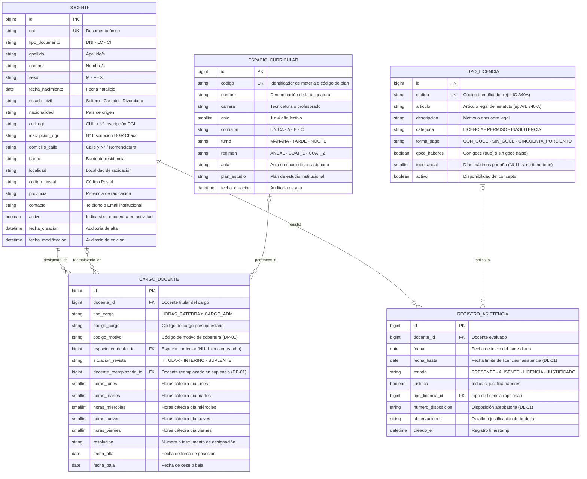

# Documentación Técnica: Modelo Entidad-Relación (DER)
## Sistema de Gestión de Asistencia y Licencias Docentes — IESETyFP

- **Institución:** Instituto de Educación Superior de Educación Técnica y Formación Profesional (IESETyFP)
- **Área:** Bedelía / Secretaría Académica
- **Módulo:** Asistencia, Carga Horaria, Régimen de Licencias y Formularios Oficiales de la Provincia del Chaco
- **Formularios Oficiales Integrados:** Formulario N° 1 de Agente, Formulario DP-01 (Designaciones y Suplencias) y Formulario DL-01 (Licencias, Permisos e Inasistencias)
- **Motor de Base de Datos:** MySQL 8.x (con compatibilidad SQLite para desarrollo local)
- **ORM:** Django 5.x

---

## 1. Diagrama Entidad-Relación (Mermaid)

El siguiente diagrama modela la estructura relacional adaptada a la normativa educativa y administrativa de la Provincia del Chaco:



---

## 2. Diccionario de Datos

### 2.1. Tabla: `docente`
Centraliza los datos filiatorios, previsionales y de radicación del personal del IESETyFP (según Formulario N° 1 de Agente - Provincia del Chaco).

| Campo | Tipo Django | Tipo MySQL | Restricciones | Descripción |
| :--- | :--- | :--- | :--- | :--- |
| `id` | `BigAutoField` | `BIGINT AUTO_INCREMENT` | **PK**, NOT NULL | Clave primaria autoincremental. |
| `dni` | `CharField(max_length=20)` | `VARCHAR(20)` | **UNIQUE**, NOT NULL, INDEX | Documento Nacional de Identidad. |
| `tipo_documento` | `CharField(max_length=10)` | `VARCHAR(10)` | NULLABLE, DEFAULT 'DNI' | Tipo de documento (DNI, LC, CI, Pasaporte). |
| `apellido` | `CharField(max_length=100)` | `VARCHAR(100)` | NOT NULL | Apellido(s) del agente docente. |
| `nombre` | `CharField(max_length=100)` | `VARCHAR(100)` | NOT NULL | Nombre(s) del agente docente. |
| `sexo` | `CharField(max_length=1)` | `VARCHAR(1)` | NOT NULL | Opciones: `M` (Masculino), `F` (Femenino), `X` (No binario). |
| `fecha_nacimiento` | `DateField()` | `DATE` | NULLABLE | Fecha de nacimiento del docente. |
| `estado_civil` | `CharField(max_length=20)` | `VARCHAR(20)` | NULLABLE | Estado civil (Soltero/a, Casado/a, Divorciado/a, Viudo/a). |
| `nacionalidad` | `CharField(max_length=50)` | `VARCHAR(50)` | NULLABLE, DEFAULT 'Argentina' | Nacionalidad del agente. |
| `cuil_dgi` | `CharField(max_length=20)` | `VARCHAR(20)` | NULLABLE | CUIL / N° Inscripción DGI (Form. N° 1). |
| `inscripcion_dgr` | `CharField(max_length=20)` | `VARCHAR(20)` | NULLABLE | N° Inscripción DGR Provincia del Chaco. |
| `domicilio_calle` | `CharField(max_length=150)` | `VARCHAR(150)` | NULLABLE | Calle y N° / Nomenclatura catastral de residencia. |
| `barrio` | `CharField(max_length=100)` | `VARCHAR(100)` | NULLABLE | Barrio del domicilio particular. |
| `localidad` | `CharField(max_length=100)` | `VARCHAR(100)` | NULLABLE, DEFAULT 'Resistencia' | Localidad del domicilio. |
| `codigo_postal` | `CharField(max_length=10)` | `VARCHAR(10)` | NULLABLE, DEFAULT '3500' | Código postal provincial. |
| `provincia` | `CharField(max_length=50)` | `VARCHAR(50)` | NULLABLE, DEFAULT 'Chaco' | Provincia de radicación. |
| `contacto` | `CharField(max_length=150)` | `VARCHAR(150)` | NULLABLE | Teléfono celular, correo institucional o de contacto. |
| `activo` | `BooleanField(default=True)` | `TINYINT(1)` | NOT NULL, DEFAULT 1 | Estado de actividad laboral del docente. |
| `fecha_creacion` | `DateTimeField(auto_now_add=True)` | `DATETIME(6)` | NOT NULL | Timestamp de alta en el sistema. |
| `fecha_modificacion` | `DateTimeField(auto_now=True)` | `DATETIME(6)` | NOT NULL | Timestamp de última actualización. |

---

### 2.2. Tabla: `espacio_curricular`
Representa asignaturas, materias, talleres o módulos con su régimen académico, comisión y turno.

| Campo | Tipo Django | Tipo MySQL | Restricciones | Descripción |
| :--- | :--- | :--- | :--- | :--- |
| `id` | `BigAutoField` | `BIGINT AUTO_INCREMENT` | **PK**, NOT NULL | Clave primaria. |
| `codigo` | `CharField(max_length=30)` | `VARCHAR(30)` | **UNIQUE**, NOT NULL | Código institucional o de plan de estudio (ej: `DS-301`). |
| `nombre` | `CharField(max_length=150)` | `VARCHAR(150)` | NOT NULL | Nombre de la asignatura. |
| `carrera` | `CharField(max_length=150)` | `VARCHAR(150)` | NOT NULL | Carrera técnica o profesorado. |
| `anio` | `PositiveSmallIntegerField()` | `SMALLINT UNSIGNED` | NOT NULL | Año de la carrera (1, 2, 3, etc.). |
| `comision` | `CharField(max_length=10)` | `VARCHAR(10)` | NOT NULL, DEFAULT 'UNICA' | Comisión de cursada: `UNICA`, `A`, `B`, `C`. |
| `turno` | `CharField(max_length=10)` | `VARCHAR(10)` | NOT NULL, DEFAULT 'NOCHE' | Turno de dictado: `MANANA`, `TARDE`, `NOCHE`. |
| `regimen` | `CharField(max_length=10)` | `VARCHAR(10)` | NOT NULL, DEFAULT 'ANUAL' | Régimen académico: `ANUAL`, `CUAT_1`, `CUAT_2`. |
| `aula` | `CharField(max_length=50)` | `VARCHAR(50)` | NULLABLE | Aula o espacio físico asignado en el instituto. |
| `plan_estudio` | `CharField(max_length=50)` | `VARCHAR(50)` | NULLABLE | Instrumento de plan de estudio (ej: `Res. 4500/22`). |
| `fecha_creacion` | `DateTimeField(auto_now_add=True)` | `DATETIME(6)` | NOT NULL | Fecha y hora de alta. |

---

### 2.3. Tabla: `cargo_docente`
Designación de un docente frente a alumnos o en funciones institucionales/bedelía (Formulario DP-01 de Designaciones y Suplencias).

| Campo | Tipo Django | Tipo MySQL | Restricciones | Descripción |
| :--- | :--- | :--- | :--- | :--- |
| `id` | `BigAutoField` | `BIGINT AUTO_INCREMENT` | **PK**, NOT NULL | Clave primaria. |
| `docente_id` | `ForeignKey(Docente)` | `BIGINT` | **FK**, NOT NULL, `ON DELETE PROTECT` | Agente titular o designado en el cargo. |
| `tipo_cargo` | `CharField(max_length=20)` | `VARCHAR(20)` | NOT NULL, DEFAULT 'HORAS_CATEDRA' | `HORAS_CATEDRA` o `CARGO_ADM`. |
| `codigo_cargo` | `CharField(max_length=50)` | `VARCHAR(50)` | NULLABLE | Código interno o presupuestario del cargo. |
| `codigo_motivo` | `CharField(max_length=10)` | `VARCHAR(10)` | NULLABLE | Código de motivo de cobertura según Formulario DP-01. |
| `espacio_curricular_id` | `ForeignKey(EspacioCurricular)` | `BIGINT` | **FK**, NULLABLE, `ON DELETE PROTECT` | Asignatura dictada (NULL si es cargo administrativo/bedel). |
| `situacion_revista` | `CharField(max_length=15)` | `VARCHAR(15)` | NOT NULL | `TITULAR`, `INTERINO`, `SUPLENTE`. |
| `docente_reemplazado_id` | `ForeignKey(Docente)` | `BIGINT` | **FK**, NULLABLE, `ON DELETE SET_NULL` | Docente titular suplido. Obligatorio si situación es `SUPLENTE`. |
| `horas_lunes` | `PositiveSmallIntegerField(default=0)` | `SMALLINT UNSIGNED` | NOT NULL, DEFAULT 0 | Horas cátedra frente a curso los lunes. |
| `horas_martes` | `PositiveSmallIntegerField(default=0)` | `SMALLINT UNSIGNED` | NOT NULL, DEFAULT 0 | Horas cátedra frente a curso los martes. |
| `horas_miercoles` | `PositiveSmallIntegerField(default=0)` | `SMALLINT UNSIGNED` | NOT NULL, DEFAULT 0 | Horas cátedra frente a curso los miércoles. |
| `horas_jueves` | `PositiveSmallIntegerField(default=0)` | `SMALLINT UNSIGNED` | NOT NULL, DEFAULT 0 | Horas cátedra frente a curso los jueves. |
| `horas_viernes` | `PositiveSmallIntegerField(default=0)` | `SMALLINT UNSIGNED` | NOT NULL, DEFAULT 0 | Horas cátedra frente a curso los viernes. |
| `resolucion` | `CharField(max_length=100)` | `VARCHAR(100)` | NULLABLE | Resolución o instrumento de designación. |
| `fecha_alta` | `DateField(null=True, blank=True)` | `DATE` | NULLABLE | Fecha de alta o toma de posesión del cargo. |
| `fecha_baja` | `DateField(null=True, blank=True)` | `DATE` | NULLABLE | Fecha de baja o cese de funciones. |

---

### 2.4. Tabla: `tipo_licencia`
Catálogo normativo de licencias, permisos e inasistencias docentes (Formulario DL-01 - Provincia del Chaco).

| Campo | Tipo Django | Tipo MySQL | Restricciones | Descripción |
| :--- | :--- | :--- | :--- | :--- |
| `id` | `BigAutoField` | `BIGINT AUTO_INCREMENT` | **PK**, NOT NULL | Clave primaria. |
| `codigo` | `CharField(max_length=20)` | `VARCHAR(20)` | **UNIQUE**, NOT NULL | Código identificador (ej: `LIC-340A`, `PERM-50`). |
| `articulo` | `CharField(max_length=50)` | `VARCHAR(50)` | NOT NULL | Encuadre legal estatutario (ej: *Art. 340-A*). |
| `descripcion` | `CharField(max_length=255)` | `VARCHAR(255)` | NOT NULL | Detalle o alcance normativo. |
| `categoria` | `CharField(max_length=15)` | `VARCHAR(15)` | NOT NULL, DEFAULT 'LICENCIA' | `LICENCIA`, `PERMISO`, `INASISTENCIA`. |
| `forma_pago` | `CharField(max_length=25)` | `VARCHAR(25)` | NOT NULL, DEFAULT 'CON_GOCE' | `CON_GOCE`, `SIN_GOCE`, `CINCUENTA_PORCIENTO`. |
| `goce_haberes` | `BooleanField(default=True)` | `TINYINT(1)` | NOT NULL, DEFAULT 1 | Sincronizado automáticamente: `True` si forma de pago es `CON_GOCE`. |
| `tope_anual` | `PositiveSmallIntegerField(null=True)` | `SMALLINT UNSIGNED` | NULLABLE | Días anuales máximos admisibles. |
| `activo` | `BooleanField(default=True)` | `TINYINT(1)` | NOT NULL, DEFAULT 1 | Estado de vigencia del artículo legal. |

---

### 2.5. Tabla: `registro_asistencia`
Control diario de asistencia y novedades docentes de Bedelía (Formulario DL-01).

| Campo | Tipo Django | Tipo MySQL | Restricciones | Descripción |
| :--- | :--- | :--- | :--- | :--- |
| `id` | `BigAutoField` | `BIGINT AUTO_INCREMENT` | **PK**, NOT NULL | Clave primaria. |
| `docente_id` | `ForeignKey(Docente)` | `BIGINT` | **FK**, NOT NULL, `ON DELETE CASCADE` | Agente docente del parte diario. |
| `fecha` | `DateField()` | `DATE` | NOT NULL, INDEX | Fecha o jornada inicial de la novedad. |
| `fecha_hasta` | `DateField(null=True, blank=True)` | `DATE` | NULLABLE | Fecha límite de la inasistencia o licencia (DL-01). |
| `estado` | `CharField(max_length=15)` | `VARCHAR(15)` | NOT NULL | `PRESENTE`, `AUSENTE`, `LICENCIA`, `JUSTIFICADO`. |
| `justifica` | `BooleanField(default=True)` | `TINYINT(1)` | NOT NULL, DEFAULT 1 | Indica si la inasistencia justifica el cómputo de haberes. |
| `tipo_licencia_id` | `ForeignKey(TipoLicencia)` | `BIGINT` | **FK**, NULLABLE, `ON DELETE SET_NULL` | Artículo o tipo de licencia solicitado. |
| `numero_disposicion` | `CharField(max_length=50)` | `VARCHAR(50)` | NULLABLE | Número de disposición rectoral o instrumento aprobatorio. |
| `observaciones` | `TextField(blank=True)` | `TEXT` | NULLABLE | Anotaciones, número de certificado médico o justificación. |
| `creado_el` | `DateTimeField(auto_now_add=True)` | `DATETIME(6)` | NOT NULL | Marca temporal de registro. |

---

## 3. Enumeraciones y Opciones del Sistema (Choices)

### Situación de Revista (`CargoDocente.situacion_revista`)
- `TITULAR`: Designación definitiva por concurso.
- `INTERINO`: Cobertura en cargo vacante transitorio.
- `SUPLENTE`: Reemplazo transitorio de un titular/interino. **Requiere obligatoriamente especificar `docente_reemplazado` (Formulario DP-01).**

### Tipo de Cargo (`CargoDocente.tipo_cargo`)
- `HORAS_CATEDRA`: Cargo docente tradicional frente a alumnos vinculado a un `EspacioCurricular`.
- `CARGO_ADM`: Cargo administrativo institucional, bedelía, auxiliares de laboratorio o CIE. Permite `materia = NULL`.

### Comisión (`EspacioCurricular.comision`)
- `UNICA`: Comisión única.
- `A`: Comisión A.
- `B`: Comisión B.
- `C`: Comisión C.

### Turno (`EspacioCurricular.turno`)
- `MANANA`: Turno Mañana.
- `TARDE`: Turno Tarde.
- `NOCHE`: Turno Noche (predeterminado de nivel superior).

### Régimen Académico (`EspacioCurricular.regimen`)
- `ANUAL`: Asignatura de duración anual.
- `CUAT_1`: Primer Cuatrimestre.
- `CUAT_2`: Segundo Cuatrimestre.

### Categoría de Licencia (`TipoLicencia.categoria`)
- `LICENCIA`: Licencia médica, extraordinaria o de largo tratamiento.
- `PERMISO`: Permiso especial institucional, gremial o por examen.
- `INASISTENCIA`: Inasistencia justificada o computada por día.

### Forma de Pago (`TipoLicencia.forma_pago`)
- `CON_GOCE`: Con Goce íntegro de haberes (`goce_haberes = True`).
- `SIN_GOCE`: Sin goce de haberes (`goce_haberes = False`).
- `CINCUENTA_PORCIENTO`: Con 50% de haberes (`goce_haberes = False`).

### Estado de Asistencia (`RegistroAsistencia.estado`)
- `PRESENTE`: El docente asistió a dictar sus horas programadas.
- `AUSENTE`: Falta injustificada sin amparo normativo.
- `LICENCIA`: Inasistencia encuadrada legalmente (`tipo_licencia` mandatorio).
- `JUSTIFICADO`: Ausencia institucionalmente justificada (comisión de servicio, causas de fuerza mayor).

---

## 4. Reglas de Integridad Referencial y Lógica de Negocio

1. **Validación de Suplencias (Formulario DP-01):**
   - Si `CargoDocente.situacion_revista == 'SUPLENTE'`, el campo `docente_reemplazado` es **obligatorio**.
   - Se valida a nivel de modelo en el método `clean()`:
     ```python
     if self.situacion_revista == "SUPLENTE" and not self.docente_reemplazado:
         raise ValidationError({
             "docente_reemplazado": (
                 "Debe especificar el docente reemplazado para una suplencia "
                 "según Formulario DP-01"
             )
         })
     ```

2. **Cargos No Frente a Alumnos / Administrativos:**
   - Para cargos de Bedelía, auxiliares docentes o coordinaciones (`tipo_cargo == 'CARGO_ADM'`), el campo `materia` es opcional (`null=True, blank=True`).

3. **Sincronización de Haberes en Licencias (Formulario DL-01):**
   - El modelo `TipoLicencia` sincroniza en su método `save()` el campo booleano `goce_haberes`:
     ```python
     if not self.goce_haberes and self.forma_pago == "CON_GOCE":
         self.forma_pago = "SIN_GOCE"
     else:
         self.goce_haberes = (self.forma_pago == "CON_GOCE")
     ```
   - Esto garantiza plena retrocompatibilidad con integraciones y reportes existentes.

4. **Período de Novedad de Asistencia (DL-01):**
   - `RegistroAsistencia` admite registrar novedades que abarcan múltiples días a través de `fecha` (inicio) y `fecha_hasta` (conclusión), junto a `numero_disposicion` y el indicador `justifica`.

5. **Unicidad de Asistencia Diaria:**
   - Un docente solo puede registrar un parte diario por fecha natural (`UniqueConstraint(fields=['docente', 'fecha'])`).

---

## 5. Implementación de Referencia en Django ORM

```python
from django.db import models
from django.core.exceptions import ValidationError


class Docente(models.Model):
    SEXO_CHOICES = [
        ("M", "Masculino"),
        ("F", "Femenino"),
        ("X", "No binario"),
    ]

    dni = models.CharField(max_length=20, unique=True, verbose_name="DNI")
    tipo_documento = models.CharField(
        max_length=10,
        default="DNI",
        blank=True,
        null=True,
        verbose_name="Tipo de Documento",
    )
    apellido = models.CharField(max_length=100, verbose_name="Apellido")
    nombre = models.CharField(max_length=100, verbose_name="Nombre")
    sexo = models.CharField(
        max_length=1,
        choices=SEXO_CHOICES,
        default="M",
        verbose_name="Sexo",
    )
    fecha_nacimiento = models.DateField(
        blank=True,
        null=True,
        verbose_name="Fecha de Nacimiento",
    )
    estado_civil = models.CharField(
        max_length=20,
        blank=True,
        null=True,
        verbose_name="Estado Civil",
    )
    nacionalidad = models.CharField(
        max_length=50,
        default="Argentina",
        blank=True,
        null=True,
        verbose_name="Nacionalidad",
    )
    cuil_dgi = models.CharField(
        max_length=20,
        blank=True,
        null=True,
        verbose_name="CUIL / N° Inscripción DGI",
    )
    inscripcion_dgr = models.CharField(
        max_length=20,
        blank=True,
        null=True,
        verbose_name="N° Inscripción DGR",
    )
    domicilio_calle = models.CharField(
        max_length=150,
        blank=True,
        null=True,
        verbose_name="Calle y N° / Nomenclatura",
    )
    barrio = models.CharField(
        max_length=100,
        blank=True,
        null=True,
        verbose_name="Barrio",
    )
    localidad = models.CharField(
        max_length=100,
        default="Resistencia",
        blank=True,
        null=True,
        verbose_name="Localidad",
    )
    codigo_postal = models.CharField(
        max_length=10,
        default="3500",
        blank=True,
        null=True,
        verbose_name="Código Postal",
    )
    provincia = models.CharField(
        max_length=50,
        default="Chaco",
        blank=True,
        null=True,
        verbose_name="Provincia",
    )
    contacto = models.CharField(
        max_length=150,
        blank=True,
        null=True,
        verbose_name="Contacto (Teléfono/Email)",
    )
    activo = models.BooleanField(default=True, verbose_name="Activo")
    fecha_creacion = models.DateTimeField(
        auto_now_add=True, verbose_name="Fecha de Creación"
    )
    fecha_modificacion = models.DateTimeField(
        auto_now=True, verbose_name="Fecha de Modificación"
    )

    class Meta:
        verbose_name = "Docente"
        verbose_name_plural = "Docentes"
        ordering = ["apellido", "nombre"]

    def __str__(self):
        return f"{self.apellido}, {self.nombre} (DNI: {self.dni})"


class EspacioCurricular(models.Model):
    COMISION_CHOICES = [
        ("UNICA", "Única"),
        ("A", "Comisión A"),
        ("B", "Comisión B"),
        ("C", "Comisión C"),
    ]
    TURNO_CHOICES = [
        ("MANANA", "Mañana"),
        ("TARDE", "Tarde"),
        ("NOCHE", "Noche"),
    ]
    REGIMEN_CHOICES = [
        ("ANUAL", "Anual"),
        ("CUAT_1", "1° Cuatrimestre"),
        ("CUAT_2", "2° Cuatrimestre"),
    ]

    codigo = models.CharField(
        max_length=30, unique=True, verbose_name="Código de Espacio"
    )
    nombre = models.CharField(
        max_length=150, verbose_name="Nombre de la Asignatura"
    )
    carrera = models.CharField(max_length=150, verbose_name="Carrera")
    anio = models.PositiveSmallIntegerField(verbose_name="Año de la Carrera")
    comision = models.CharField(
        max_length=10,
        choices=COMISION_CHOICES,
        default="UNICA",
        verbose_name="Comisión",
    )
    turno = models.CharField(
        max_length=10,
        choices=TURNO_CHOICES,
        default="NOCHE",
        verbose_name="Turno",
    )
    regimen = models.CharField(
        max_length=10,
        choices=REGIMEN_CHOICES,
        default="ANUAL",
        verbose_name="Régimen de Cursado",
    )
    aula = models.CharField(
        max_length=50,
        blank=True,
        null=True,
        verbose_name="Aula",
    )
    plan_estudio = models.CharField(
        max_length=50,
        blank=True,
        null=True,
        verbose_name="Plan de Estudio",
    )
    fecha_creacion = models.DateTimeField(
        auto_now_add=True, verbose_name="Fecha de Creación"
    )

    class Meta:
        verbose_name = "Espacio Curricular"
        verbose_name_plural = "Espacios Curriculares"
        ordering = ["carrera", "anio", "nombre"]

    def __str__(self):
        return f"{self.codigo} - {self.nombre} ({self.carrera} - {self.anio}° Año)"


class CargoDocente(models.Model):
    SITUACION_CHOICES = [
        ("TITULAR", "Titular"),
        ("INTERINO", "Interino"),
        ("SUPLENTE", "Suplente"),
    ]
    TIPO_CARGO_CHOICES = [
        ("HORAS_CATEDRA", "Horas Cátedra"),
        ("CARGO_ADM", "Cargo Administrativo / Bedel"),
    ]

    docente = models.ForeignKey(
        Docente,
        on_delete=models.PROTECT,
        related_name="cargos",
        verbose_name="Docente",
    )
    tipo_cargo = models.CharField(
        max_length=20,
        choices=TIPO_CARGO_CHOICES,
        default="HORAS_CATEDRA",
        verbose_name="Tipo de Cargo",
    )
    codigo_cargo = models.CharField(
        max_length=50,
        blank=True,
        null=True,
        verbose_name="Código de Cargo",
    )
    codigo_motivo = models.CharField(
        max_length=10,
        blank=True,
        null=True,
        verbose_name="Código de Motivo",
    )
    materia = models.ForeignKey(
        EspacioCurricular,
        on_delete=models.PROTECT,
        null=True,
        blank=True,
        related_name="cargos",
        verbose_name="Espacio Curricular",
    )
    situacion_revista = models.CharField(
        max_length=15,
        choices=SITUACION_CHOICES,
        default="INTERINO",
        verbose_name="Situación de Revista",
    )
    docente_reemplazado = models.ForeignKey(
        Docente,
        on_delete=models.SET_NULL,
        null=True,
        blank=True,
        related_name="suplencias_recibidas",
        verbose_name="Docente Reemplazado",
    )
    horas_lunes = models.PositiveSmallIntegerField(
        default=0, verbose_name="Horas Lunes"
    )
    horas_martes = models.PositiveSmallIntegerField(
        default=0, verbose_name="Horas Martes"
    )
    horas_miercoles = models.PositiveSmallIntegerField(
        default=0, verbose_name="Horas Miércoles"
    )
    horas_jueves = models.PositiveSmallIntegerField(
        default=0, verbose_name="Horas Jueves"
    )
    horas_viernes = models.PositiveSmallIntegerField(
        default=0, verbose_name="Horas Viernes"
    )
    resolucion = models.CharField(
        max_length=100,
        blank=True,
        null=True,
        verbose_name="Resolución de Designación",
    )
    fecha_alta = models.DateField(
        blank=True, null=True, verbose_name="Fecha de Alta"
    )
    fecha_baja = models.DateField(
        blank=True, null=True, verbose_name="Fecha de Baja"
    )

    class Meta:
        verbose_name = "Cargo Docente"
        verbose_name_plural = "Cargos Docentes"
        ordering = ["docente__apellido", "docente__nombre"]

    def __str__(self):
        materia_display = (
            self.materia.nombre if self.materia else self.get_tipo_cargo_display()
        )
        return (
            f"{self.docente.nombre_completo} en {materia_display} "
            f"({self.get_situacion_revista_display()})"
        )

    def clean(self):
        super().clean()
        if self.situacion_revista == "SUPLENTE" and not self.docente_reemplazado:
            raise ValidationError(
                {
                    "docente_reemplazado": (
                        "Debe especificar el docente reemplazado para una suplencia "
                        "según Formulario DP-01"
                    )
                }
            )


class TipoLicencia(models.Model):
    CATEGORIA_CHOICES = [
        ("LICENCIA", "Licencia"),
        ("PERMISO", "Permiso"),
        ("INASISTENCIA", "Inasistencia"),
    ]
    FORMA_PAGO_CHOICES = [
        ("CON_GOCE", "Con Goce de haberes"),
        ("SIN_GOCE", "Sin goce de haberes"),
        ("CINCUENTA_PORCIENTO", "Con 50% de haberes"),
    ]

    codigo = models.CharField(
        max_length=20, unique=True, verbose_name="Código"
    )
    articulo = models.CharField(
        max_length=50, verbose_name="Artículo Legal (ej: 340-A)"
    )
    descripcion = models.CharField(
        max_length=255, verbose_name="Descripción"
    )
    categoria = models.CharField(
        max_length=15,
        choices=CATEGORIA_CHOICES,
        default="LICENCIA",
        verbose_name="Categoría",
    )
    forma_pago = models.CharField(
        max_length=25,
        choices=FORMA_PAGO_CHOICES,
        default="CON_GOCE",
        verbose_name="Forma de Pago",
    )
    goce_haberes = models.BooleanField(
        default=True, verbose_name="Goce de Haberes"
    )
    tope_anual = models.PositiveSmallIntegerField(
        null=True,
        blank=True,
        verbose_name="Tope Anual (Días)",
        help_text="Dejar en blanco si no tiene tope anual fijado.",
    )
    activo = models.BooleanField(default=True, verbose_name="Activo")

    class Meta:
        verbose_name = "Tipo de Licencia"
        verbose_name_plural = "Tipos de Licencias"
        ordering = ["codigo"]

    def __str__(self):
        goce = "C/Goce" if self.goce_haberes else "S/Goce"
        return f"{self.articulo} ({self.codigo}) - {self.descripcion} [{goce}]"

    def save(self, *args, **kwargs):
        if not self.goce_haberes and self.forma_pago == "CON_GOCE":
            self.forma_pago = "SIN_GOCE"
        else:
            self.goce_haberes = (self.forma_pago == "CON_GOCE")
        super().save(*args, **kwargs)


class RegistroAsistencia(models.Model):
    ESTADO_CHOICES = [
        ("PRESENTE", "Presente"),
        ("AUSENTE", "Ausente"),
        ("LICENCIA", "Licencia"),
        ("JUSTIFICADO", "Justificado"),
    ]

    docente = models.ForeignKey(
        Docente,
        on_delete=models.CASCADE,
        related_name="asistencias",
        verbose_name="Docente",
    )
    fecha = models.DateField(verbose_name="Fecha")
    fecha_hasta = models.DateField(
        null=True,
        blank=True,
        verbose_name="Fecha Hasta",
    )
    estado = models.CharField(
        max_length=15,
        choices=ESTADO_CHOICES,
        default="PRESENTE",
        verbose_name="Estado de Asistencia",
    )
    justifica = models.BooleanField(
        default=True,
        verbose_name="Justifica",
    )
    tipo_licencia = models.ForeignKey(
        TipoLicencia,
        on_delete=models.SET_NULL,
        null=True,
        blank=True,
        related_name="registros_asistencia",
        verbose_name="Tipo de Licencia",
    )
    numero_disposicion = models.CharField(
        max_length=50,
        blank=True,
        null=True,
        verbose_name="Número de Disposición",
    )
    observaciones = models.TextField(
        blank=True, verbose_name="Observaciones / Justificación"
    )
    creado_el = models.DateTimeField(
        auto_now_add=True, verbose_name="Registrado el"
    )

    class Meta:
        verbose_name = "Registro de Asistencia"
        verbose_name_plural = "Registros de Asistencia"
        constraints = [
            models.UniqueConstraint(
                fields=["docente", "fecha"],
                name="unique_docente_asistencia_diaria",
            )
        ]
        ordering = ["-fecha", "docente__apellido"]

    def clean(self):
        super().clean()
        if self.estado == "LICENCIA" and not self.tipo_licencia:
            raise ValidationError(
                {
                    "tipo_licencia": (
                        "Debe especificar el Tipo de Licencia "
                        "cuando el estado es LICENCIA."
                    )
                }
            )
        if self.estado == "PRESENTE" and self.tipo_licencia:
            raise ValidationError(
                {
                    "tipo_licencia": (
                        "No debe asignar un Tipo de Licencia "
                        "si el estado es PRESENTE."
                    )
                }
            )
```
